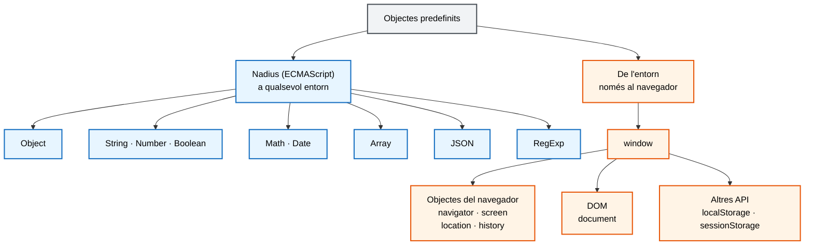
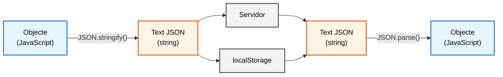
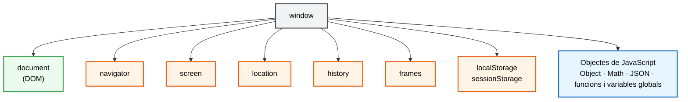
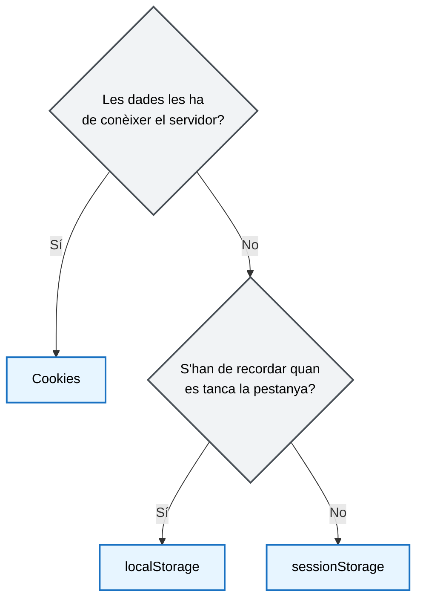
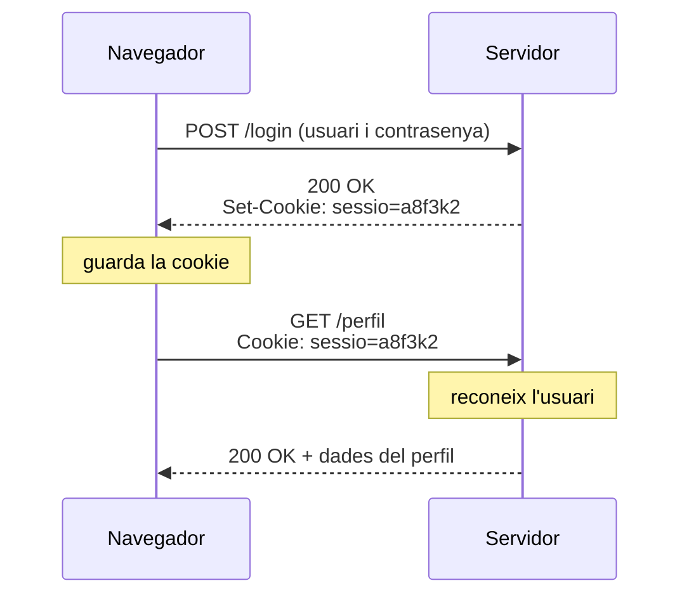

> **DSAW**  **RA3** - **OBJECTES PREDEFINITS**
>
> **Mòdul**: Client (0612)
>
> **Estat**: **En revisió**


# Objectes predefinits: el llenguatge i el navegador


## Què aprendràs

En acabar aquesta unitat has de ser capaç de:

- Utilitzar **objectes** a JavaScript: llegir, recórrer, afegir i eliminar propietats i cridar-ne els mètodes.
- Distingir els **objectes nadius** del llenguatge dels **objectes de l'entorn** que aporta el navegador.
- Analitzar l'objecte **`window`** i els objectes del navegador (`navigator`, `screen`, `location`, `history` i `document`).
- Escriure codi que canviï l'**aspecte del navegador** i del document que hi conté.
- Interactuar amb l'usuari mitjançant els **diàlegs del navegador** i l'element **`<dialog>`**.
- Treballar amb **diverses finestres**: obrir-les, tancar-les i comunicar-les entre elles.
- **Emmagatzemar** i recuperar informació al navegador amb `cookies`, `sessionStorage` i `localStorage`.
- **Depurar** i **documentar** el codi amb les eines del navegador i JSDoc.

---

## Índex

1. [Els objectes a JavaScript](#1-els-objectes-a-javascript)
2. [Classificació dels objectes predefinits](#2-classificació-dels-objectes-predefinits)
3. [L'objecte `window` i els objectes del navegador](#3-lobjecte-window-i-els-objectes-del-navegador)
4. [Canviar l'aspecte del navegador i del document](#4-canviar-laspecte-del-navegador-i-del-document)
5. [Interactuar amb l'usuari: els diàlegs](#5-interactuar-amb-lusuari-els-diàlegs)
6. [Documents amb diverses finestres](#6-documents-amb-diverses-finestres)
7. [Emmagatzematge al navegador](#7-emmagatzematge-al-navegador)
8. [Depurar i documentar el codi](#8-depurar-i-documentar-el-codi)

---

## 1. Els objectes a JavaScript

JavaScript és un llenguatge dissenyat al voltant del concepte d'**objecte**. Gairebé tot el que fem servir es comporta com un objecte: els arrays, les dates, les funcions, el document HTML i la mateixa finestra del navegador. Fins i tot el format d'intercanvi de dades més utilitzat a la web, **JSON**, vol dir *JavaScript Object Notation*.

### 1.1 Per què necessitem objectes

Imagina que has de guardar les dades d'un alumne només amb variables:

```js
// Incorrecte: dades relacionades escampades en variables independents
const nomAlumne = "Marta";
const edatAlumne = 19;
const cicleAlumne = "DAW";

// I si n'hi ha dos? Cal inventar més noms...
const nomAlumne2 = "Pau";
const edatAlumne2 = 20;
const cicleAlumne2 = "DAM";
```

Aquest codi té diversos problemes:

- **Les dades no estan agrupades**: res no indica que `nomAlumne` i `edatAlumne` són del mateix alumne. Només ho sabem pel nom de la variable.
- **No escala**: cada alumne nou obliga a crear tres variables noves amb un altre nom.
- **És difícil de passar a una funció**: per mostrar un alumne cal passar totes les dades una per una, i si afegim un camp nou, s'han de canviar totes les crides.

```js
// Incorrecte: cada dada és un paràmetre
function mostrarAlumne(nom, edat, cicle) { /* ... */ }
mostrarAlumne(nomAlumne, edatAlumne, cicleAlumne);
```

Un **objecte** resol aquests problemes perquè agrupa en un sol valor totes les dades d'un mateixa concepte:

```js
// Correcte: un objecte per alumne
const alumne1 = { nom: "Marta", edat: 19, cicle: "DAW" };
const alumne2 = { nom: "Pau", edat: 20, cicle: "DAM" };

// Es passa a la funció com un sol paràmetre
function mostrarAlumne(alumne) {
    console.log(`${alumne.nom} (${alumne.edat} anys) - ${alumne.cicle}`);
}

mostrarAlumne(alumne1);   // "Marta (19 anys) - DAW"

// I es poden guardar en una llista
const classe = [alumne1, alumne2];
```

Els objectes serveixen per:

- **Representar coses del món real** amb totes les seves característiques: un alumne, un producte, una comanda, la configuració d'una aplicació.
- **Agrupar les dades i les accions** que hi treballen. Un objecte pot tenir funcions pròpies (mètodes), com `alumne.saludar()`.
- **Intercanviar dades amb el servidor**. Les dades que arriben d'un servidor solen tenir forma d'objecte (en format JSON, apartat 2.3).

### 1.2 Propietats i mètodes

> - **Objecte**: col·lecció de parelles **clau: valor**.
> - **Propietat**: cada una d'aquestes parelles. La clau és el nom de la propietat.
> - **Mètode**: propietat el valor de la qual és una funció. Representa una acció que l'objecte sap fer.

El valor d'una propietat pot ser un valor primitiu (`number`, `string`, `boolean`...), un altre objecte, un array o una funció.

```js
// Objecte literal: la forma habitual de crear un objecte
const alumne = {
    nom: "Marta",                 // string
    edat: 19,                    // number
    matriculat: true,            // boolean
    moduls: ["0612", "0613"],    // array
    adreca: {                    // objecte dins d'un objecte
        ciutat: "Girona",
        cp: "17001"
    },
    saludar() {                  // mètode
        return "Hola, soc la Marta";
    }
};
```
### 1.3 Accedir a les propietats

Hi ha dues notacions per llegir o escriure una propietat:

| Notació | Sintaxi | Quan s'utilitza |
| :--- | :--- | :--- |
| **De punt** | `objecte.propietat` | La més habitual, quan coneixem el nom de la propietat |
| **De claudàtors** | `objecte["propietat"]` | Quan el nom de la propietat està guardat en una variable o té caràcters especials |

```js
console.log(alumne.nom);              // "Marta"
console.log(alumne["edat"]);          // 19
console.log(alumne.adreca.ciutat);    // "Girona"
console.log(alumne.moduls[0]);        // "0612"
console.log(alumne.saludar());        // "Hola, soc la Marta"  (els mètodes es criden amb parèntesis)

// El nom de la propietat està en una variable: només funciona amb claudàtors
const camp = "edat";
console.log(alumne[camp]);            // 19
console.log(alumne.camp);             // undefined: busca una propietat que es diu "camp"
```

Si llegim una propietat que no existeix, obtenim `undefined`. Si intentem llegir una propietat d'un valor `undefined`, es produeix un error. L'operador d'**encadenament opcional** `?.` evita aquest error:

```js
console.log(alumne.telefon);              // undefined
// console.log(alumne.feina.empresa);     // MALAMENT: TypeError, alumne.feina és undefined
console.log(alumne.feina?.empresa);       // BÉ: undefined, sense error
```

### 1.4 Recórrer un objecte

El bucle `for...in` recorre els noms de les propietats d'un objecte:

```js
const producte = { nom: "Teclat", preu: 39.9, estoc: 12 };

for (const clau in producte) {
    console.log(`${clau}: ${producte[clau]}`);   // cal la notació de claudàtors
}
// nom: Teclat
// preu: 39.9
// estoc: 12
```

L'objecte predefinit `Object` ofereix mètodes que converteixen un objecte en un array, i aleshores el podem recórrer amb `for...of`:

| Mètode | Retorna | Exemple amb `producte` |
| :--- | :--- | :--- |
| `Object.keys(obj)` | Array amb els noms de les propietats | `["nom", "preu", "estoc"]` |
| `Object.values(obj)` | Array amb els valors | `["Teclat", 39.9, 12]` |
| `Object.entries(obj)` | Array de parelles `[clau, valor]` | `[["nom", "Teclat"], ["preu", 39.9], ...]` |

```js
for (const [clau, valor] of Object.entries(producte)) {
    console.log(clau, valor);
}

console.log(Object.keys(producte).length);   // 3: nombre de propietats
```

> **Compte:** `for...in` és per a objectes i `for...of` és per a arrays i altres col·leccions iterables.

### 1.5 Afegir, modificar i eliminar propietats

Els objectes que creem són dinàmics: podem afegir-hi propietats en qualsevol moment, encara que l'objecte s'hagi declarat amb `const`.

```js
const usuari = { nom: "Pau" };

usuari.email = "pau@exemple.cat";    // afegeix una propietat nova
usuari.nom = "Pau";            // modifica una propietat existent
delete usuari.email;                 // elimina la propietat

console.log("nom" in usuari);        // true: comprova si existeix la propietat
console.log("email" in usuari);      // false
```

> **Recorda:** `const` impedeix tornar a assignar la variable (`usuari = {}` dona error), però no impedeix modificar el contingut de l'objecte.

### 1.6 `this` dins d'un mètode

Dins d'un mètode, la paraula reservada **`this`** fa referència a l'objecte que crida el mètode. Així el mètode pot fer servir les altres propietats del mateix objecte.

```js
const persona = {
    nom: "Marta",
    anyNaixement: 2005,

    // Correcte: this és l'objecte persona
    edat() {
        return new Date().getFullYear() - this.anyNaixement;
    },

    // Incorrecte: depèn del nom de la variable. Si es canvia el nom, deixa de funcionar
    edatMalament() {
        return new Date().getFullYear() - persona.anyNaixement;
    }
};

console.log(persona.edat());   // 21 (el 2026)
```

> **IMPORTANT:** les funcions fletxa no tenen `this` propi. No les facis servir per definir mètodes que necessitin accedir a l'objecte.

```js
const comptador = {
    valor: 0,
    sumar: () => this.valor++,      // MALAMENT: this no és comptador
    restar() { this.valor--; }      // BÉ
};
```

---

## 2. Classificació dels objectes predefinits

Un **objecte predefinit** és un objecte que ja existeix quan el nostre codi comença a executar-se: no l'hem de crear, només l'hem de fer servir. N'hi ha de dos tipus segons qui els proporciona.

### 2.1 Objectes nadius i objectes de l'entorn

> - **Objectes nadius** (*built-in*): formen part del llenguatge i els defineix l'estàndard **ECMAScript**. Existeixen en qualsevol entorn on s'executi JavaScript: el navegador, Node.js...
> - **Objectes de l'entorn** (*host objects*): els proporciona l'entorn d'execució. Al navegador són els **objectes del navegador** (`navigator`, `location`...) i el **DOM** (*Document Object Model*). 



### 2.2 Els objectes nadius

| Objecte | Per a què serveix | Exemple | 
| :--- | :--- | :--- |
| `Object` | Mètodes generals per treballar amb objectes | `Object.keys(obj)` | 
| `String` | Mètodes de les cadenes de text | `"hola".toUpperCase()` | 
| `Number` | Conversions i comprovacions numèriques | `Number.parseInt("12")` | 
| `Math` | Constants i funcions matemàtiques | `Math.round(4.6)` | 
| `Date` | Dates i hores | `new Date().getFullYear()` | 
| `Array` | Llistes de valors | `[1, 2, 3].includes(2)` | 
| `JSON` | Convertir objectes en text i a l'inrevés | `JSON.stringify(obj)` | 
| `RegExp` | Expressions regulars | `/^\d{5}$/.test(cp)` | 

N'hi ha que es fan servir **directament**, sense crear-ne cap instància (`Math`, `JSON`, `Object`), i n'hi ha que serveixen per **crear valors** amb `new` (`new Date()`).

### 2.3 Objecte i JSON

Objecte i JSON s'assemblen molt quan s'escriuen, però **no són el mateix**:

> - **Objecte**: és un **valor de JavaScript** que viu a la memòria mentre el programa s'executa. Podem llegir-ne les propietats, modificar-les i cridar-ne els mètodes.
> - **JSON** (*JavaScript Object Notation*): és un **format de text** per escriure dades. Un JSON és sempre un `string`. No es pot fer servir directament: és com una fotografia de l'objecte, que es pot guardar o enviar però no es pot modificar com l'original.

Les mateixes dades escrites de les dues maneres:

```js
// Objecte de JavaScript: un valor amb propietats
const alumne = {
    nom: "Laia",
    edat: 19,
    saludar() { return "Hola"; }
};

// Text en format JSON: només és un string
const alumneJSON = '{"nom":"Laia","edat":19}';

console.log(typeof alumne);       // "object"
console.log(typeof alumneJSON);   // "string"

console.log(alumne.nom);          // "Laia"
console.log(alumneJSON.nom);      // undefined: un text no té la propietat nom
console.log(alumneJSON.length);   // 24: és un text de 24 caràcters
```

| | **Objecte** | **JSON** |
| :--- | :--- | :--- |
| Què és | Un valor de JavaScript a la memòria | Un text (`string`) |
| `typeof` | `"object"` | `"string"` |
| Accés a les dades | Directe: `alumne.nom` | Cal convertir-lo abans en objecte |
| Noms de les propietats | Sense cometes (`nom: "Laia"`) | Sempre entre cometes dobles (`"nom": "Laia"`) |
| Textos | Cometes simples, dobles o `` ` `` | Només cometes dobles |
| Pot contenir funcions | Sí (mètodes) | No |
| Pot contenir `undefined`, `Date`... | Sí | No: només textos, números, booleans, `null`, arrays i objectes |
| Comentaris | Sí | No |

#### Per què cal el format JSON

Si ja tenim objectes, per què necessitem JSON? Perquè hi ha llocs on **només es pot fer servir text**:

- **Per enviar dades per la xarxa**: el protocol HTTP només transporta text. Per enviar un objecte al servidor, o per rebre'n un, cal convertir-lo en text.
- **Per guardar dades al navegador**: `localStorage` i `sessionStorage` només guarden text (apartat 7.4).
- **Per compartir dades entre llenguatges**: el servidor pot estar fet amb PHP, Python o Java. Cap d'aquests llenguatges entén un objecte de JavaScript, però tots saben llegir un text JSON.



#### L'objecte predefinit `JSON`

Per passar d'un a l'altre, JavaScript té l'objecte predefinit **`JSON`**, amb dos mètodes:

| Mètode | Converteix | Ús habitual |
| :--- | :--- | :--- |
| `JSON.stringify(valor)` | Objecte o array → text JSON | Guardar dades o enviar-les al servidor |
| `JSON.parse(text)` | Text JSON → objecte o array | Recuperar dades guardades o rebudes |

> **Nota:** no confonguis el **format JSON** (el text) amb l'**objecte `JSON`** (l'eina que el converteix). Són dues coses diferents que es diuen igual.

```js
const comanda = {
    id: 125,
    client: "Anna",
    productes: ["llibre", "llibreta"],
    pagada: false
};

// De l'objecte al text
const text = JSON.stringify(comanda);
console.log(text);
// {"id":125,"client":"Anna","productes":["llibre","llibreta"],"pagada":false}
console.log(typeof text);    // "string"

// Del text a l'objecte
const copia = JSON.parse(text);
console.log(copia.productes[1]);   // "llibreta"
console.log(typeof copia);         // "object"
```

> **Compte:** no tots els valors sobreviuen a la conversió. Els mètodes i les propietats amb valor `undefined` desapareixen, i les dates es converteixen en text i no tornen a ser objectes `Date` en fer `JSON.parse`.

---

## 3. L'objecte `window` i els objectes del navegador

### 3.1 `window`, l'objecte global

**`window`** és l'objecte principal de l'entorn del navegador. Cada finestra o pestanya té el seu propi objecte `window`, que conté:

- Totes les variables i funcions globals del nostre codi i del llenguatge.
- El **DOM**: l'objecte `document`, que representa la pàgina carregada.
- Els **objectes del navegador**: els objectes que representen el navegador i la finestra.



Com que `window` és l'objecte global, no cal escriure'l. Les dues línies següents són equivalents:

```js
window.document.getElementById("capcalera");
document.getElementById("capcalera");
```

### 3.2 `navigator`

L'objecte **`navigator`** dona informació sobre el navegador i el dispositiu.

| Propietat | Retorna | Exemple |
| :--- | :--- | :--- |
| `language` | Idioma preferit del navegador | `"ca-ES"` |
| `languages` | Array amb els idiomes preferits, per ordre | `["ca-ES", "es", "en"]` |
| `userAgent` | Text que identifica el navegador i el sistema | `"Mozilla/5.0 (Windows NT 10.0...)"` |
| `onLine` | Si hi ha connexió a la xarxa | `true` |
| `cookieEnabled` | Si les cookies estan activades | `true` |

```js
// Mostrar un missatge de benvinguda segons l'idioma del navegador
const idioma = navigator.language.slice(0, 2);   // "ca-ES" → "ca"

const salutacions = { ca: "Benvingut", es: "Bienvenido", en: "Welcome" };
const salutacio = salutacions[idioma];   // anglès si l'idioma no hi és

document.querySelector("h1").textContent = salutacio;
```

### 3.3 `screen`

L'objecte **`screen`** descriu la **pantalla física** de l'usuari, no la finestra del navegador.

| Propietat | Retorna |
| :--- | :--- |
| `width` / `height` | Amplada i alçada totals de la pantalla, en píxels |
| `availWidth` / `availHeight` | Espai disponible, sense la barra de tasques del sistema |
| `orientation.type` | Orientació: `"landscape-primary"`, `"portrait-primary"`... |

```js
console.log(`Pantalla: ${screen.width} x ${screen.height}`);
console.log(`Disponible: ${screen.availWidth} x ${screen.availHeight}`);

// Comparació: la mida de la finestra pot ser molt més petita que la pantalla
console.log(`Finestra: ${window.innerWidth} x ${window.innerHeight}`);
```

### 3.4 `location`

L'objecte **`location`** conté la URL de la pàgina actual i permet navegar a una altra. Prenem com a exemple la URL `http://127.0.0.1:5500/joc.html?nivell=2&mode=facil#puntuacions`:

| Propietat | Valor |
| :--- | :--- |
| `href` | `"http://127.0.0.1:5500/joc.html?nivell=2&mode=facil#puntuacions"` |
| `protocol` | `"http:"` |
| `hostname` | `"127.0.0.1"` |
| `port` | `"5500"` |
| `host` | `"127.0.0.1:5500"` (hostname i port) |
| `origin` | `"http://127.0.0.1:5500"` (protocol, hostname i port) |
| `pathname` | `"/joc.html"` |
| `search` | `"?nivell=2&mode=facil"` |
| `hash` | `"#puntuacions"` |

Els mètodes de `location` permeten carregar un altre document:

| Mètode | Què fa | Es pot tornar enrere? |
| :--- | :--- | :--- |
| `assign(url)` | Carrega una pàgina nova. Equival a `location.href = url` | Sí, queda a l'historial |
| `replace(url)` | Substitueix la pàgina actual per una de nova | No, no queda a l'historial |
| `reload()` | Torna a carregar la pàgina actual | — |

```js
// Anar a la pàgina de resultats (l'usuari pot tornar enrere)
location.assign("resultats.html");

// Després d'un inici de sessió: no volem que l'usuari torni al formulari amb el botó Enrere
location.replace("inici.html");
```

Per llegir els paràmetres de la URL (la part de `search`), l'objecte **`URLSearchParams`** és molt més còmode que treballar amb el text:

```js
// URL: joc.html?nivell=2&mode=facil
const parametres = new URLSearchParams(location.search);

const nivell = Number(parametres.get("nivell"));   // 2 (get sempre retorna text o null)
const mode = parametres.get("mode");               // "facil"
const temps = parametres.get("temps");             // null: no hi és

if (parametres.has("mode")) {
    console.log(`Mode de joc: ${mode}`);
}
```

### 3.5 `history`

L'objecte **`history`** permet moure's per l'historial de la pestanya, com fan els botons Enrere i Endavant del navegador. Per privacitat, no permet llegir les URL visitades.

| Membre | Què fa |
| :--- | :--- |
| `length` | Nombre d'entrades de l'historial de la pestanya |
| `back()` | Torna a la pàgina anterior |
| `forward()` | Va a la pàgina següent |
| `go(n)` | Es mou `n` posicions: `go(-2)` torna dues pàgines enrere |

```js
// Botó "Tornar" propi de la pàgina
document.querySelector("#tornar").addEventListener("click", () => {
    if (history.length > 1) {
        history.back();
    } else {
        location.assign("index.html");   // si no hi ha historial, anem a l'inici
    }
});
```

### 3.6 `document`

L'objecte **`document`** representa la pàgina HTML carregada a la finestra i és l'arrel del DOM, que es treballa a la unitat 05. Algunes propietats donen informació general sobre el document:

| Propietat | Retorna |
| :--- | :--- |
| `title` | Títol de la pàgina (l'etiqueta `<title>`) |
| `URL` | URL del document |
| `referrer` | URL de la pàgina des de la qual s'ha arribat, si n'hi ha |
| `lastModified` | Data de l'última modificació |
| `readyState` | Estat de càrrega: `"loading"`, `"interactive"` o `"complete"` |
| `documentElement` | L'element `<html>` |
| `body` | L'element `<body>` |
| `cookie` | Les cookies de la pàgina (apartat 7.2) |

```js
console.log(document.title);         // "Joc de memòria"
console.log(document.referrer);      // "http://127.0.0.1:5500/index.html"
console.log(document.readyState);    // "interactive" si l'script té defer
```

---

## 4. Canviar l'aspecte del navegador i del document

Els objectes de l'apartat anterior no només serveixen per consultar informació: molts permeten modificar què veu l'usuari.

### 4.1 El títol i el desplaçament

El títol que es mostra a la pestanya es pot canviar en qualsevol moment. És una manera habitual d'avisar l'usuari quan està en una altra pestanya:

```js
const titolOriginal = document.title;

function mostrarMissatgesPendents(quantitat) {
    document.title = quantitat > 0
        ? `(${quantitat}) ${titolOriginal}`   // "(3) Correu"
        : titolOriginal;
}

mostrarMissatgesPendents(3);
```

Per desplaçar el contingut de la finestra:

| Membre | Què fa |
| :--- | :--- |
| `window.scrollY` / `window.scrollX` | Píxels que s'ha desplaçat la pàgina en vertical i en horitzontal |
| `window.scrollTo(opcions)` | Desplaça la pàgina fins a una posició |
| `window.scrollBy(opcions)` | Desplaça la pàgina una quantitat relativa a la posició actual |
| `element.scrollIntoView(opcions)` | Desplaça la pàgina fins que l'element és visible |

```js
// Botó "Tornar a dalt" amb desplaçament suau
document.querySelector("#amunt").addEventListener("click", () => {
    window.scrollTo({ top: 0, behavior: "smooth" });
});

// Portar l'usuari al primer error d'un formulari
document.querySelector(".error")?.scrollIntoView({ behavior: "smooth", block: "center" });
```

## 5. Interactuar amb l'usuari: els diàlegs

Hi ha dues maneres de mostrar una finestra de diàleg a l'usuari: els diàlegs que ja porta el navegador, molt senzills però gens personalitzables, i l'element HTML `<dialog>`, que és l'opció que es fa servir a les aplicacions actuals.

### 5.1 Els diàlegs del navegador: `alert`, `confirm` i `prompt`

L'objecte `window` té tres mètodes que mostren una finestra de diàleg del navegador:

| Mètode | Mostra | Retorna |
| :--- | :--- | :--- |
| `alert(missatge)` | Un missatge i un botó Acceptar | `undefined` |
| `confirm(missatge)` | Un missatge i els botons Acceptar i Cancel·lar | `true` si accepta, `false` si cancel·la |
| `prompt(missatge, valorInicial)` | Un missatge i un camp de text | El text escrit (sempre `string`), o `null` si cancel·la |

```js
alert("La partida començarà quan premis Acceptar");

if (confirm("Segur que vols esborrar la partida guardada?")) {
    console.log("Partida esborrada");
}

const resposta = prompt("Quants jugadors sou?", "2");

if (resposta === null) {
    console.log("L'usuari ha cancel·lat");
} else {
    const jugadors = Number(resposta);   // prompt sempre retorna text: cal convertir-lo
    console.log(`Partida per a ${jugadors} jugadors`);
}
```

Aquests diàlegs tenen limitacions importants:

- **Bloquegen la pàgina**: mentre el diàleg és obert, el codi s'atura i l'usuari no pot fer res més.
- **No es poden personalitzar**: l'aspecte depèn del navegador i no se'n pot canviar el disseny ni el text dels botons.
- **Només admeten text**: no s'hi pot posar un formulari, una imatge ni cap altre element.

### 5.2 L'element `<dialog>`

**`<dialog>`** és un element d'HTML que representa una finestra de diàleg dins de la mateixa pàgina. Per defecte està amagat. JavaScript l'obre i el tanca, i el seu contingut i el seu aspecte es defineixen amb HTML i CSS com qualsevol altre element.

| | `alert` / `confirm` / `prompt` | `<dialog>` |
| :--- | :--- | :--- |
| Aspecte | El decideix el navegador | Es dissenya amb CSS |
| Contingut | Només text | Qualsevol HTML: text, formularis, imatges, botons... |
| Bloqueja el codi | Sí, el programa s'atura | No, la resposta arriba amb un esdeveniment |

#### Obrir i tancar el diàleg

L'element `<dialog>` és un objecte del DOM amb aquests mètodes i propietats:

| Membre | Què fa |
| :--- | :--- |
| `showModal()` | L'obre com a **modal**: es mostra a sobre de tot, enfosqueix la resta de la pàgina i no s'hi pot interactuar fins que es tanca |
| `show()` | L'obre com a **no modal**: la resta de la pàgina continua sent accessible |
| `close(valor)` | El tanca. Opcionalment, desa un text a `returnValue` |
| `open` | `true` si el diàleg és obert |
| `returnValue` | Text amb què s'ha tancat el diàleg |

Un diàleg modal també es tanca quan l'usuari prem la tecla Esc.

```html
<button id="obrir-ajuda">Ajuda</button>

<dialog id="ajuda">
    <h2>Com es juga</h2>
    <p>Gira dues cartes. Si són iguals, te les quedes.</p>
    <button id="tancar-ajuda">Tancar</button>
</dialog>
```

```js
const ajuda = document.querySelector("#ajuda");

document.querySelector("#obrir-ajuda").addEventListener("click", () => {
    ajuda.showModal();   // l'obre a sobre de la pàgina
});

document.querySelector("#tancar-ajuda").addEventListener("click", () => {
    ajuda.close();       // el torna a amagar
});
```

Quan s'obre com a modal, el navegador mostra darrere del diàleg una capa que cobreix la pàgina. Es pot personalitzar amb el pseudoelement **`::backdrop`**:

```css
dialog {
    border: none;
    border-radius: 8px;
    padding: 1.5rem;
    max-width: 400px;
}

/* Capa que enfosqueix la pàgina darrere del diàleg modal */
dialog::backdrop {
    background-color: rgb(0 0 0 / 0.5);
}
```

#### Recollir la resposta de l'usuari

Un formulari amb **`method="dialog"`** dins del diàleg no envia res al servidor: en prémer un dels seus botons, tanca el diàleg i desa el `value` del botó a `returnValue`. Quan el diàleg es tanca, sigui com sigui (un botó, `close()` o la tecla Esc), es llança l'esdeveniment **`close`**.

Amb això podem substituir un `confirm`:

```html
<button id="esborrar">Esborrar partida</button>

<dialog id="confirmacio">
    <form method="dialog">
        <p>Segur que vols esborrar la partida guardada?</p>
        <button value="cancel">Cancel·lar</button>
        <button value="ok">Esborrar</button>
    </form>
</dialog>
```

```js
const confirmacio = document.querySelector("#confirmacio");

document.querySelector("#esborrar").addEventListener("click", () => {
    confirmacio.returnValue = "";   // esborrem la resposta anterior
    confirmacio.showModal();
});

// La resposta arriba quan el diàleg es tanca
confirmacio.addEventListener("close", () => {
    if (confirmacio.returnValue === "ok") {
        console.log("Partida esborrada");
    } else {
        console.log("No s'ha esborrat res");   // Cancel·lar o tecla Esc
    }
});
```

I també un `prompt`, amb l'avantatge que podem fer servir qualsevol camp de formulari i la seva validació:

```html
<dialog id="dialeg-nom">
    <form method="dialog">
        <label for="nom">Com et dius?</label>
        <input id="nom" required>
        <button value="ok">Començar</button>
    </form>
</dialog>
```

```js
const dialegNom = document.querySelector("#dialeg-nom");
dialegNom.showModal();

dialegNom.addEventListener("close", () => {
    if (dialegNom.returnValue === "ok") {
        const nom = document.querySelector("#nom").value;
        document.querySelector("h1").textContent = `Hola, ${nom}`;
    }
});
```

---

## 6. Documents amb diverses finestres

Una aplicació web pot fer servir més d'una finestra: una finestra emergent amb les instruccions d'un joc, una finestra de pagament, un `iframe` amb un mapa... Cada una té el seu propi objecte `window`, i JavaScript permet obrir-les, controlar-les i comunicar-les entre elles.

### 6.1 Obrir i tancar finestres

El mètode **`window.open(url, nom, característiques)`** obre una pestanya o una finestra nova:

| Paràmetre | Significat |
| :--- | :--- |
| `url` | Pàgina que es carrega a la finestra nova |
| `nom` | Nom de la finestra. Si ja n'hi ha una d'oberta amb el mateix nom, s'hi carrega la URL en lloc d'obrir-ne una altra. `"_blank"` obre sempre una finestra nova |
| `característiques` | Text amb opcions separades per comes: `popup`, `width`, `height`, `left`, `top`, `noopener` |

```js
// Pestanya nova
window.open("ajuda.html", "_blank");

// Finestra emergent de 400 x 300 a la posició (100, 100)
const finestra = window.open(
    "instruccions.html",
    "instruccions",
    "popup,width=400,height=300,left=100,top=100"
);
```

`window.open` retorna una **referència** a l'objecte `window` de la finestra nova, i amb aquesta referència la podem controlar:

```js
let instruccions = null;

document.querySelector("#obrir").addEventListener("click", () => {
    instruccions = window.open("instruccions.html", "instruccions", "popup,width=400,height=300");

    if (instruccions === null) {
        alert("El navegador ha bloquejat la finestra emergent");
    }
});

document.querySelector("#tancar").addEventListener("click", () => {
    if (instruccions && !instruccions.closed) {   // closed: true si ja s'ha tancat
        instruccions.close();
    }
});

document.querySelector("#engrandir").addEventListener("click", () => {
    instruccions?.resizeTo(800, 600);   // funciona perquè l'hem oberta des del codi
    instruccions?.focus();              // la porta al davant
});
```

Alguns detalls que cal tenir en compte:

- **Bloqueig de finestres emergents**: els navegadors només permeten `window.open` quan és la resposta directa a una acció de l'usuari, com un clic. Si es crida en carregar la pàgina, normalment es bloqueja i retorna `null`.
- **`close()`** tanca la finestra. Una pàgina només pot tancar les finestres que ha obert ella mateixa amb `window.open`. Si l'usuari ha obert la pestanya, `window.close()` no fa res.
- **`noopener`**: si s'afegeix a les característiques, la finestra nova no té accés a la que l'ha oberta i `window.open` retorna `null`. És recomanable quan s'obren pàgines d'altres llocs web.


### 6.2 Els `iframe`

Un element **`<iframe>`** insereix un altre document HTML dins de la pàgina. Cada `iframe` té el seu propi objecte `window`.

| Des de... | Per accedir a... | Fem servir |
| :--- | :--- | :--- |
| La pàgina principal | La finestra de l'`iframe` | `iframe.contentWindow` o `window.frames[0]` |
| La pàgina principal | El document de l'`iframe` | `iframe.contentDocument` (només si és del mateix origen) |
| L'`iframe` | La pàgina que el conté | `window.parent` |
| L'`iframe` | La finestra de més amunt | `window.top` |

```html
<!-- principal.html -->
<iframe id="marcador" src="marcador.html" width="300" height="100"></iframe>
<button id="sumar">Sumar punt</button>

<script>
    const iframe = document.querySelector("#marcador");

    document.querySelector("#sumar").addEventListener("click", () => {
        // Mateix origen: accedim directament al document de l'iframe
        const punts = iframe.contentDocument.querySelector("#punts");
        punts.textContent = Number(punts.textContent) + 1;
    });
</script>
```

```html
<!-- marcador.html -->
<p>Punts: <span id="punts">0</span></p>
```


---

## 7. Emmagatzematge al navegador

Per defecte, quan l'usuari recarrega la pàgina o tanca el navegador, totes les variables del nostre codi es perden. El navegador ofereix diversos mecanismes per **guardar informació al client** i recuperar-la més endavant.

### 7.1 Comparativa dels mecanismes

| | **Cookies** | **sessionStorage** | **localStorage** |
| :--- | :--- | :--- | :--- |
| **Capacitat** | Uns 4 KB per cookie | Uns 5 MB | Uns 5-10 MB |
| **Durada** | Fins a la data de caducitat, o fins que es tanca el navegador | Fins que es tanca la pestanya | Permanent, fins que s'esborra |
| **Abast** | Totes les pestanyes del lloc | Només la pestanya actual | Totes les pestanyes del mateix origen |
| **S'envia al servidor** | Sí, a cada petició HTTP | No | No |
| **Accés des de JavaScript** | `document.cookie` (incòmode) | API senzilla | API senzilla |
| **Ús típic** | Sessions d'usuari, preferències que el servidor ha de conèixer | Dades temporals d'un procés: un formulari en diversos passos | Preferències, dades que s'han de recordar entre visites |



### 7.2 Cookies

Una **cookie** és una petita informació en format `nom=valor` que el navegador guarda i que **envia automàticament al servidor** en cada petició al mateix lloc. Es fan servir per a:

- **Gestió de sessions**: el servidor crea un identificador de sessió, l'envia en una cookie i el navegador el retorna a cada petició. Així el servidor sap que l'usuari ha iniciat la sessió.
- **Personalització**: preferències de l'usuari, com l'idioma.
- **Seguiment**: registre del comportament de l'usuari, per exemple amb finalitats estadístiques o publicitàries.



#### Crear una cookie

Des de JavaScript, les cookies es gestionen amb la propietat **`document.cookie`**. Té un funcionament peculiar: **assignar-hi un valor no substitueix totes les cookies, sinó que n'afegeix o en modifica una**.

```js
document.cookie = "idioma=ca";
document.cookie = "tema=fosc";

console.log(document.cookie);   // "idioma=ca; tema=fosc"
```

Després de la parella `nom=valor` s'hi poden afegir **atributs** separats per punt i coma:

| Atribut | Significat |
| :--- | :--- |
| `max-age=segons` | Segons que dura la cookie. Si no s'indica ni aquest atribut ni `expires`, la cookie s'esborra en tancar el navegador |
| `expires=data` | Data de caducitat en format UTC. Fa el mateix que `max-age`, però és menys pràctic |
| `path=/` | Camins del lloc on la cookie és visible. `/` vol dir tot el lloc |
| `SameSite=Lax` | Controla si la cookie s'envia en peticions que vénen d'altres llocs: `Strict`, `Lax` (per defecte) o `None` |
| `Secure` | La cookie només s'envia per HTTPS. És obligatori si es fa servir `SameSite=None` |

```js
// Cookie que dura 30 dies i és visible a tot el lloc
const trentaDies = 60 * 60 * 24 * 30;
document.cookie = `idioma=ca; max-age=${trentaDies}; path=/; SameSite=Lax`;

// El valor no pot contenir ; , ni espais: cal codificar-lo
const ciutat = "L'Hospitalet de Llobregat";
document.cookie = `ciutat=${encodeURIComponent(ciutat)}; max-age=${trentaDies}; path=/`;
```

> **Compte:** una data de caducitat en el passat no crea la cookie, sinó que l'esborra. Si un exemple fa servir `expires=Thu, 1 Jan 2023 00:00:00 UTC`, avui la cookie ja no es guardarà.

#### Llegir una cookie

`document.cookie` retorna totes les cookies en un sol text, amb el format `"nom1=valor1; nom2=valor2"`. Per obtenir-ne una cal separar el text:

```js
/**
 * Retorna el valor d'una cookie.
 * @param {string} nom Nom de la cookie.
 * @returns {string | null} El valor descodificat, o null si no existeix.
 */
function llegirCookie(nom) {
    const cookies = document.cookie.split("; ");     // ["idioma=ca", "tema=fosc"]

    for (const cookie of cookies) {
        const [clau, valor] = cookie.split("=");
        if (clau === nom) {
            return decodeURIComponent(valor);
        }
    }
    return null;
}

console.log(llegirCookie("idioma"));   // "ca"
console.log(llegirCookie("ciutat"));   // "L'Hospitalet de Llobregat"
console.log(llegirCookie("res"));      // null
```

#### Eliminar una cookie

No hi ha cap mètode per esborrar cookies. Es tornen a crear amb el mateix nom i el mateix `path`, i amb una durada de zero segons:

```js
function esborrarCookie(nom) {
    document.cookie = `${nom}=; max-age=0; path=/`;
}

esborrarCookie("tema");
```

> **Nota:** el servidor pot crear cookies amb l'atribut `HttpOnly`. Aquestes cookies no apareixen a `document.cookie` i JavaScript no les pot llegir ni modificar. És la manera segura de guardar l'identificador de sessió, perquè un script maliciós no el pot robar.

### 7.3 Web Storage: `sessionStorage` i `localStorage`

La **Web Storage API** permet guardar parelles clau/valor al navegador d'una manera molt més senzilla que les cookies. Ofereix dos objectes amb exactament els mateixos mètodes:

- **`sessionStorage`**: les dades duren mentre la pestanya és oberta. Cada pestanya té el seu propi espai, encara que sigui de la mateixa pàgina.
- **`localStorage`**: les dades es mantenen encara que es tanqui el navegador i s'apagui l'ordinador. Només desapareixen si s'esborren des del codi o si l'usuari esborra les dades del lloc.

Les dades es guarden per **origen**: una pàgina no pot veure el que ha guardat una pàgina d'un altre origen.

| Membre | Què fa |
| :--- | :--- |
| `setItem(clau, valor)` | Guarda un valor. Si la clau ja existeix, la substitueix |
| `getItem(clau)` | Retorna el valor de la clau, o `null` si no existeix |
| `removeItem(clau)` | Elimina una clau |
| `clear()` | Elimina totes les dades de l'origen |
| `key(index)` | Retorna el nom de la clau que és a la posició indicada |
| `length` | Nombre de claus guardades |

```js
// Guardar
localStorage.setItem("nom", "Joan");
localStorage.setItem("record", 1500);

// Recuperar
const nom = localStorage.getItem("nom");          // "Joan"
const record = localStorage.getItem("record");    // "1500": és un text!
const color = localStorage.getItem("color");      // null: no existeix

// Eliminar
localStorage.removeItem("record");

// Recórrer totes les claus
for (let i = 0; i < localStorage.length; i++) {
    const clau = localStorage.key(i);
    console.log(clau, localStorage.getItem(clau));
}

// Esborrar-ho tot
localStorage.clear();
```

> **Compte:** Web Storage només guarda **text**. Els números i els booleans es converteixen en text en guardar-los, i els hem de tornar a convertir en llegir-los.

```js
localStorage.setItem("punts", 10);
localStorage.setItem("so", false);

// MALAMENT
const punts = localStorage.getItem("punts") + 5;          // "105": concatena textos
if (localStorage.getItem("so")) { console.log("so ON"); } // s'executa: "false" és truthy

// BÉ
const puntsOk = Number(localStorage.getItem("punts")) + 5;   // 15
const soOk = localStorage.getItem("so") === "true";          // false
```

Exemple amb `sessionStorage`: un comptador de visites a la pàgina durant la sessió.

```js
// Si encara no existeix, getItem retorna null i Number(null) és 0
const visites = Number(sessionStorage.getItem("visites")) + 1;
sessionStorage.setItem("visites", visites);

document.querySelector("#visites").textContent =
    `Has carregat aquesta pàgina ${visites} vegades en aquesta pestanya`;
```

### 7.4 Guardar objectes i arrays

Com que Web Storage només guarda text, per guardar un objecte o un array cal convertir-lo a JSON amb `JSON.stringify` i recuperar-lo amb `JSON.parse` (apartat 2.3).

```js
const configuracio = {
    idioma: navigator.language,
    tema: "fosc",
    mida: 16
};

// MALAMENT: es guarda el text "[object Object]"
localStorage.setItem("configuracio", configuracio);

// BÉ: guardar
localStorage.setItem("configuracio", JSON.stringify(configuracio));

// BÉ: recuperar
const guardada = JSON.parse(localStorage.getItem("configuracio"));
console.log(guardada.tema);   // "fosc"
```

> **Nota:** `JSON.parse(null)` retorna `null`. Per això l'operador `??` ens permet donar un valor per defecte quan la clau encara no existeix.

### 7.5 Seguretat i bones pràctiques

- **No guardis dades sensibles**: contrasenyes, dades bancàries o *tokens* d'accés. Qualsevol script que s'executi a la pàgina, també un de maliciós, pot llegir `localStorage`, `sessionStorage` i les cookies sense `HttpOnly`.
- **No et refiïs de les dades guardades**: l'usuari les pot veure i modificar des de les eines de desenvolupament. Si la informació és important, el servidor l'ha de validar.
- **Preveu que l'emmagatzematge falli**: l'espai pot estar ple o l'usuari pot tenir l'emmagatzematge desactivat (apartat 8.4).
- **Fes servir noms de clau clars i amb prefix**: `"memoria.record"` en lloc de `"r"`. Totes les pàgines del mateix origen comparteixen el mateix espai.
- **Pocs KB per a cookies**: s'envien al servidor a cada petició, i si són grans alenteixen totes les comunicacions.

> **Nota:** per guardar grans quantitats de dades estructurades (centenars de registres, fitxers), el navegador ofereix **IndexedDB**, una base de dades completa al client. Queda fora d'aquesta unitat.


---

## 8. Depurar i documentar el codi

### 8.1 La consola

A més de `console.log`, l'objecte **`console`** té mètodes que fan la sortida més fàcil de llegir:

| Mètode | Ús |
| :--- | :--- |
| `console.log(...)` | Missatge informatiu |
| `console.warn(...)` | Avís, es mostra en groc |
| `console.error(...)` | Error, es mostra en vermell i amb la traça de crides |
| `console.table(dades)` | Mostra un objecte o un array d'objectes en forma de taula |
| `console.dir(objecte)` | Mostra totes les propietats d'un objecte, desplegables |
| `console.group(títol)` / `console.groupEnd()` | Agrupa missatges |

```js
console.table({ idioma: navigator.language, online: navigator.onLine, amplada: innerWidth });

console.group("URL actual");
console.log("origin:", location.origin);
console.log("pathname:", location.pathname);
console.log("search:", location.search);
console.groupEnd();

console.dir(window.location);   // totes les propietats i mètodes de location
```

### 8.2 Punts d'interrupció

Un **punt d'interrupció** (*breakpoint*) atura l'execució del codi en una línia concreta. Mentre el codi està aturat, podem veure el valor de totes les variables i avançar línia a línia.

### 8.3 El panell Application

El panell **Application** de Chrome i Edge (**Storage** a Firefox) permet veure i modificar tot el que la pàgina ha guardat al navegador:

- **Local Storage** i **Session Storage**: les claus i els valors de cada origen. Es poden editar, afegir i esborrar a mà.
- **Cookies**: cada cookie amb el seu valor, la caducitat, el `path` i els atributs `HttpOnly`, `Secure` i `SameSite`.

### 8.4 Gestionar errors amb `try...catch`

Alguns objectes predefinits poden llançar errors que aturen el programa si no els tractem. La sentència **`try...catch`** permet capturar l'error i continuar.

```js
try {
    // codi que pot fallar
} catch (error) {
    // què fem si falla: error conté la informació de l'error
}
```

Tres situacions habituals en aquesta unitat:

**1. `JSON.parse` amb un text que no és JSON vàlid**. Pot passar si l'usuari ha modificat el valor des del panell Application o si una versió anterior del codi guardava un altre format.

```js
localStorage.setItem("configuracio", "{tema: fosc}");   // no és JSON vàlid

// MALAMENT: SyntaxError i s'atura tot el programa
// const config = JSON.parse(localStorage.getItem("configuracio"));

// BÉ
let config;
try {
    config = JSON.parse(localStorage.getItem("configuracio"));
} catch (error) {
    console.warn("Configuració incorrecta, es fa servir la per defecte", error.message);
    config = { tema: "clar" };
}
```

**2. L'emmagatzematge està ple**. `setItem` llança un error de tipus `QuotaExceededError`.

```js
try {
    localStorage.setItem("imatge", textMoltLlarg);
} catch (error) {
    if (error.name === "QuotaExceededError") {
        alert("No queda espai per guardar les dades");
    }
}
```

**3. L'emmagatzematge no està disponible**. Si l'usuari ha bloquejat les dades dels llocs web, només accedir a `localStorage` ja pot llançar un error.

```js
/**
 * Comprova si localStorage es pot fer servir.
 * @returns {boolean}
 */
function storageDisponible() {
    try {
        const prova = "__prova__";
        localStorage.setItem(prova, prova);
        localStorage.removeItem(prova);
        return true;
    } catch {
        return false;
    }
}
```

### 8.5 Documentar amb JSDoc

Com a la unitat 04, documentem les funcions amb comentaris **JSDoc**. Quan les funcions treballen amb objectes, l'etiqueta `@typedef` permet descriure l'estructura de l'objecte una sola vegada i fer-la servir a totes les funcions:

```js
/**
 * Puntuació d'una partida.
 * @typedef {Object} Puntuacio
 * @property {string} jugador Nom del jugador.
 * @property {number} punts Punts obtinguts.
 * @property {string} data Data de la partida en format ISO.
 */

/**
 * Afegeix una puntuació al rànquing guardat a localStorage
 * i hi deixa només les 5 millors.
 * @param {Puntuacio} puntuacio Puntuació que s'ha d'afegir.
 * @returns {Puntuacio[]} El rànquing actualitzat.
 */
function afegirAlRanquing(puntuacio) {
    const ranquing = JSON.parse(localStorage.getItem("joc.ranquing")) ?? [];
    ranquing.push(puntuacio);
    ranquing.sort((a, b) => b.punts - a.punts);
    const millors = ranquing.slice(0, 5);
    localStorage.setItem("joc.ranquing", JSON.stringify(millors));
    return millors;
}
```

Els editors com Visual Studio Code llegeixen aquests comentaris i mostren l'ajuda i l'autocompletat de les propietats de l'objecte mentre escrivim.


