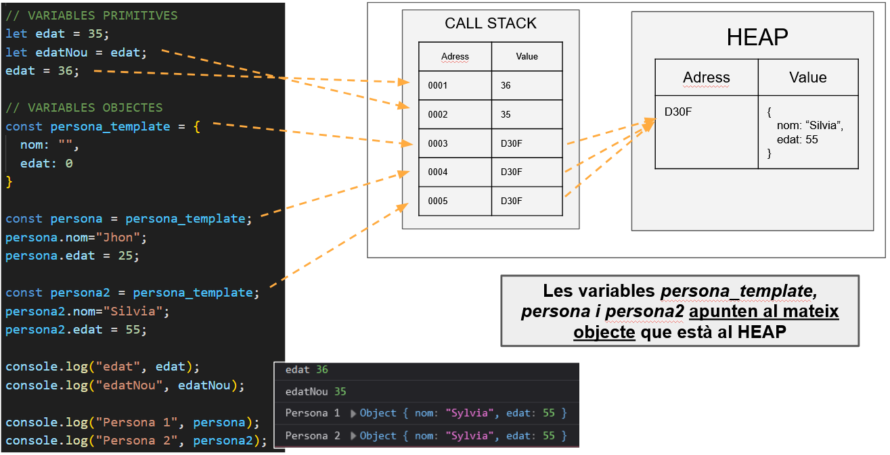
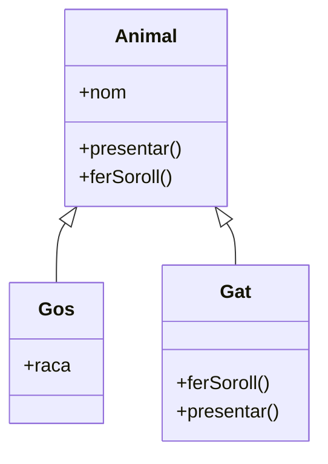
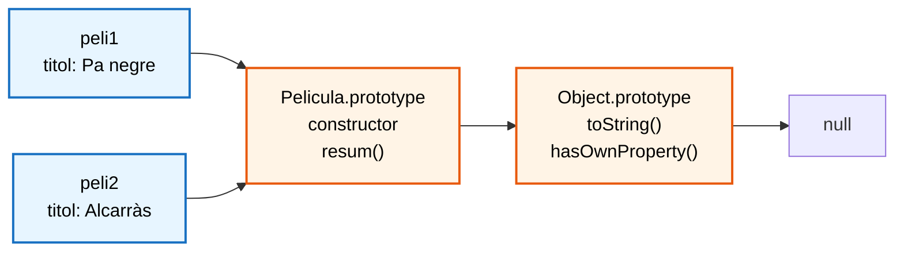

> **DSAW**  **RA4** - **ESTRUCTURES DEFINIDES PEL PROGRAMADOR**
>
> **Mòdul**: Client (0612)
>
> **Estat**: **En revisió**


# Col·leccions i objectes definits pel programador


## Què aprendràs

En acabar aquesta unitat has de ser capaç de:

- Reconèixer les característiques d'**orientació a objectes** de JavaScript.
- Definir **classes** amb propietats, mètodes, membres privats, getters, setters, membres estàtics i herència.
- Reconèixer les característiques dels **arrays** a JavaScript i distingir entre valors i referències.
- Crear, recórrer i modificar arrays, i triar el mètode adequat per a cada operació.
- Utilitzar les col·leccions **Set** i **Map** quan siguin més adequades que un array.
- Filtrar i transformar arrays amb **operacions agregades** i encadenar-les.
- Fer servir objectes propis en una aplicació organitzada en **mòduls**.
- Separar el codi en **capes de responsabilitat**: model, servei, persistència i presentació, amb fitxers de constants i utilitats.


---

## Índex

1. [Orientació a objectes a JavaScript](#1-orientació-a-objectes-a-javascript)
2. [Definició de classes](#2-definició-de-classes)
3. [Arrays](#3-arrays)
4. [Set i Map](#4-set-i-map)
5. [Operacions agregades](#5-operacions-agregades)
6. [Mòduls ES: import i export](#6-mòduls-es-import-i-export)
7. [Capes de responsabilitat](#7-capes-de-responsabilitat)
8. [Desestructuració i operador spread](#8-desestructuració-i-operador-spread)
9. [Herència basada en prototips](#9-herència-basada-en-prototips)


---

## 1. Orientació a objectes a JavaScript

### 1.1 El problema dels objectes

**Res no garanteix que tots els objectes tinguin la mateixa estructura**. Cada objecte s'escriu a mà i un nom de propietat diferent, una propietat oblidada o un tipus incorrecte no produeixen cap error:

```js
const peli1 = { titol: "Pa negre", any: 2010, nota: 4.2 };
const peli2 = { title: "Alcarràs", any: 2022 };            // nom diferent i sense nota
const peli3 = { titol: "Estiu 1993", any: "2017", nota: 4 }; // any com a text

const cataleg = [peli1, peli2, peli3];

for (const peli of cataleg) {
  console.log(peli.titol, peli.nota);
}
// Pa negre 4.2
// undefined undefined     <- l'error passa desapercebut
// Estiu 1993 4
```

**Un objecte no es pot fer servir com a plantilla**. Si s'assigna a una altra variable, no es crea un objecte nou: les dues variables apunten al mateix objecte, perquè guarden la seva adreça a la memòria i no el contingut.

La imatge següent mostra què passa a la memòria. Els valors primitius es copien a la pila, de manera que `edatNou` conserva el 35 encara que `edat` canviï. En canvi, `persona_template`, `persona` i `persona2` tenen cadascuna la seva casella a la pila, però totes tres hi guarden la mateixa adreça (`D30F`), que apunta a un únic objecte dins del HEAP. Per això l'últim canvi, `"Silvia"`, es veu des de totes tres variables.




Els objectes literals continuen sent útils. La tria depèn del que es necessiti:

| Característica | Objecte literal | Classe |
| :--- | :--- | :--- |
| Reutilització | No | Sí |
| Estructura garantida | No | Sí, la defineix el constructor |
| Herència | Poc habitual | `extends` |
| Getters i setters | Sí | Sí |
| Membres privats | No | Sí |
| Ús habitual | Configuració, dades, JSON | Estructuració de dades |

### 1.2 Les classes com a plantilla

Una **classe** és una plantilla que defineix quines propietats i quins mètodes tindran els objectes d'un tipus. Cada objecte creat a partir de la classe, o **instància**, té la mateixa estructura:

```js
class Pelicula {
  constructor(titol, any) {
    this.titol = titol;
    this.any = any;
  }
  resum() {
    return `${this.titol} (${this.any})`;
  }
}

const p1 = new Pelicula("Pa negre", 2010);
const p2 = new Pelicula("Alcarràs", 2022);

console.log(typeof p1);                // object
console.log(p1 === p2);                // false: dos objectes diferents
console.log(p1 instanceof Pelicula);   // true: se'n coneix el tipus
```

JavaScript té algunes particularitats respecte d'altres llenguatges orientats a objectes:

- L'herència es basa en **prototips** (secció 9). La sintaxi `class` és una manera més clara d'escriure aquest mecanisme.
- Els tipus no es declaren i no hi ha sobrecàrrega de mètodes.
- Els objectes són dinàmics: se'ls poden afegir propietats en temps d'execució.
- La privacitat s'indica amb el prefix `#`, en lloc de paraules com `private`.

---

## 2. Definició de classes

### 2.1 `class`, `constructor` i `new`

Una **classe** defineix l'estructura dels objectes d'un tipus. El **constructor** és el mètode que s'executa en crear una instància, i `new` és l'operador que la crea. Dins la classe, `this` fa referència a la instància.

```js
class Pelicula {
  constructor(titol, any) {
    this.titol = titol;
    this.any = any;
  }
}

const peli1 = new Pelicula("Pa negre", 2010);
const peli2 = new Pelicula("Alcarràs", 2022);

console.log(peli1.titol);                 // "Pa negre"
console.log(peli2.any);                   // 2022
```

> **Recorda:** els noms de classe s'escriuen en *PascalCase* i, a diferència de les function declaration, una classe s'ha de definir abans d'utilitzar-la.

### 2.2 Propietats i mètodes

Les propietats es poden inicialitzar al constructor o declarar directament al cos de la classe. Els mètodes s'escriuen sense la paraula `function`. 

```js
class Pelicula {
  reproduccions = 0;

  constructor(titol, minuts) {
    this.titol = titol;
    this.minuts = minuts;
  }

  durada() {
    return `${Math.floor(this.minuts / 60)}h ${this.minuts % 60}min`;
  }

  reproduir() {
    this.reproduccions++;
    return this;
  }
}

const peli = new Pelicula("Alcarràs", 120);
console.log(peli.durada());          // "2h 0min"

peli.reproduir().reproduir();
console.log(peli.reproduccions);     // 2
```

### 2.3 Membres privats

Una propietat o un mètode amb el prefix `#` només és accessible des de dins de la classe. Les propietats privades s'han de declarar al cos de la classe.

```js
class Client {
  #nif;                       // propietat privada

  constructor(nom, nif) {
    this.nom = nom;
    this.#nif = nif;
  }

  mostrarInfo() {
    return `${this.nom}, NIF ${this.#nifProtegit()}`;
  }

  // Mètode privat: retorna una versió oculta sense alterar #nif
  #nifProtegit() {
    return "*****" + this.#nif.slice(5);
  }
}

const client = new Client("Joan", "12345678Z");
console.log(client.mostrarInfo());   // "Joan, NIF *****678Z"
console.log(client.nif);             // undefined

// client.#nif;                      // SyntaxError: no s'hi pot accedir des de fora
```

### 2.4 Getters i setters

Un **getter** i un **setter** s'utilitzen com una propietat, però executen codi. Permeten validar les dades i exposar valors calculats.

```js
class Producte {
  #preu;

  constructor(nom, preu) {
    this.nom = nom;
    this.preu = preu;         // crida el setter i, per tant, valida
  }

  get preu() {
    return this.#preu;
  }

  set preu(valor) {
    if (valor < 0) {
      throw new RangeError("El preu no pot ser negatiu");
    }
    this.#preu = valor;
  }

  // Propietat calculada: només té getter
  get preuAmbIva() {
    return this.#preu * 1.21;
  }
}

const lloguer = new Producte("Lloguer 48 h", 100);
lloguer.preu = 200;                // sense parèntesis
console.log(lloguer.preu);         // 200
console.log(lloguer.preuAmbIva);   // 242
```

> **Compte:** un getter o setter no pot accedir a una propietat amb el seu mateix nom. Si dins de `set preu(valor)` escrivim `this.preu = valor`, el setter es crida a si mateix indefinidament i es produeix un `RangeError`. Per això el valor es guarda a `#preu`.

```js
class Malament {
  constructor(edat) {
    this.edat = edat;
  }
  set edat(valor) {
    this.edat = valor;   // MALAMENT: recursió infinita
  }
}

try {
  new Malament(30);
} catch (error) {
  console.log(error.name);   // "RangeError"
}
```

### 2.5 `static`

Els atributs i mètodes **estàtics** pertanyen a la classe, no a les instàncies. Es poden utilitzar sense crear cap instància, i són útils per agrupar funcionalitats i atributs d'un mateix concepte.

```js
class Matematica {
  static sumar(a, b) {
    return a + b;
  }

  static restar(a, b) {
    return a - b;
  }
}

// No fa falta fer una instància: es crida directament amb el nom de la classe
const operacio1 = Matematica.sumar(5, 10);
const operacio2 = Matematica.restar(7, 5);

console.log(operacio1);   // 15
console.log(operacio2);   // 2
```

### 2.6 Herència: `extends` i `super`

L'**herència** permet crear una classe nova a partir d'una que ja existeix. La classe nova, o **classe filla**, rep totes les propietats i els mètodes de la **classe pare**, i hi pot afegir els seus o canviar-ne alguns.

| Paraula clau | Per a què serveix |
| :--- | :--- |
| `extends` | Indica de quina classe hereta la classe filla |
| `super(...)` | Crida el constructor del pare. S'ha de fer abans d'utilitzar `this` |
| `super.metode()` | Crida la versió del pare d'un mètode |



Partim de la classe pare:

```js
class Animal {
  constructor(nom) {
    this.nom = nom;
  }

  presentar() {
    return `Em dic ${this.nom}`;
  }

  ferSoroll() {
    return "Fa un soroll";
  }
}
```

**Pas 1. Heretar i afegir propietats.** `Gos` no defineix cap mètode, però pot fer servir tots els d'`Animal`. Només afegeix la propietat `raca`:

```js
class Gos extends Animal {
  constructor(nom, raca) {
    super(nom);         // 1. el constructor d'Animal guarda el nom
    this.raca = raca;   // 2. després, la propietat pròpia del gos
  }
}

const gos = new Gos("Rex", "border collie");

console.log(gos.nom);           // "Rex": l'ha guardat el constructor d'Animal
console.log(gos.raca);          // "border collie": és pròpia de Gos
console.log(gos.presentar());   // "Em dic Rex": el mètode és d'Animal
console.log(gos.ferSoroll());   // "Fa un soroll": el mètode és d'Animal
```

**Pas 2. Sobreescriure i ampliar mètodes.** `Gat` canvia el comportament de dos mètodes del pare:

- `ferSoroll()` es **sobreescriu**: la versió del pare deixa d'utilitzar-se.
- `presentar()` s'**amplia**: aprofita la versió del pare amb `super.presentar()` i hi afegeix text.

```js
class Gat extends Animal {
  // Sense constructor: s'utilitza el d'Animal
  ferSoroll() {
    return "Mèu";
  }

  presentar() {
    return `${super.presentar()} i soc un gat`;
  }
}

const gat = new Gat("Mixa");

console.log(gat.ferSoroll());   // "Mèu"
console.log(gat.presentar());   // "Em dic Mixa i soc un gat"
```

**Polimorfisme.** Com que totes les classes tenen els mètodes `presentar()` i `ferSoroll()`, un mateix codi pot tractar objectes de classes diferents. Cada objecte executa la versió de la seva classe:

```js
// Un array amb tres objectes de classes diferents
const animals = [
  new Animal("Bitxo"),
  new Gos("Rex", "border collie"),
  new Gat("Mixa")
];

// El mateix codi per a tots: cada objecte respon segons la seva classe
for (const animal of animals) {
  console.log(`${animal.presentar()}. ${animal.ferSoroll()}`);
}
// Em dic Bitxo. Fa un soroll         <- Animal: els seus propis mètodes
// Em dic Rex. Fa un soroll           <- Gos: els hereta d'Animal sense canvis
// Em dic Mixa i soc un gat. Mèu      <- Gat: els ha sobreescrit i ampliat
```

L'operador `instanceof` comprova si un objecte és d'una classe. Una instància de la classe filla també és una instància de la classe pare:

```js
const mixa = new Gat("Mixa");

console.log(mixa instanceof Gat);      // true
console.log(mixa instanceof Animal);   // true: un gat també és un animal
console.log(mixa instanceof Gos);      // false: un gat no és un gos
```

Si el constructor de la classe filla utilitza `this` abans de cridar `super()`, es produeix un error:

```js
class Cavall extends Animal {
  constructor(nom, alcada) {
    this.alcada = alcada;   // MALAMENT: ReferenceError, cal cridar super() primer
    super(nom);
  }
}
```

> **Compte:** la classe filla no pot accedir als membres `#` del pare. Si els necessita, el pare els ha d'exposar amb mètodes, getters o setters.

---

## 3. Arrays

### 3.1 Característiques a JavaScript

| Característica | Què significa |
| :--- | :--- |
| Mida dinàmica | Pot créixer i decréixer; no cal declarar-ne la mida |
| Contingut heterogeni | Pot barrejar tipus diferents, tot i que no és recomanable |
| Indexat des de 0 | L'últim element és a la posició `length - 1` |
| És un objecte | `typeof` retorna `"object"`; per identificar-lo s'usa `Array.isArray()` |
| Es gestiona per referència | La variable no conté l'array, sinó la seva adreça a la memòria |

```js
const mixt = ["Pa negre", 2010, true, null];

console.log(mixt.length);          // 4
console.log(typeof mixt);          // "object"
console.log(Array.isArray(mixt));  // true
```

### 3.2 Creació i accés

La forma habitual de crear un array és la notació literal. Per a casos concrets hi ha altres opcions:

```js
// Literal: la forma recomanada
const generes = ["drama", "comèdia", "terror"];
const buit = [];

// Array.from: a partir d'un iterable o generant valors
const lletres = Array.from("cine");   // ["c", "i", "n", "e"]

// fill: omple l'array amb un mateix valor
const zeros = new Array(3).fill(0);   // [0, 0, 0]

console.log(lletres, zeros);
```

> **Compte:** `new Array(3)` crea un array buit de mida 3, mentre que `new Array(3, 5)` crea `[3, 5]`. Per evitar aquesta ambigüitat, fes servir la notació literal.

S'accedeix als elements amb claudàtors. El mètode `at()` admet índexs negatius, que compten des del final.

```js
const generes = ["drama", "comèdia", "terror"];

console.log(generes[0]);             // "drama"
console.log(generes[generes.length - 1]); // "terror"
console.log(generes.at(-1));         // "terror"
console.log(generes[10]);            // undefined: no dona error

generes[1] = "musical";              // modifica una posició
console.log(generes);                // ["drama", "musical", "terror"]
```

### 3.3 Recorregut

```js
const titols = ["Pa negre", "Alcarràs", "Estiu 1993"];

// for clàssic: quan cal controlar l'índex o el pas
for (let i = 0; i < titols.length; i++) {
  console.log(i, titols[i]);
}

// for...of: quan només interessa el valor
for (const titol of titols) {
  console.log(titol);
}

// for...of amb entries(): valor i índex.
// [index, titol] és una desestructuració (secció 8)
for (const [index, titol] of titols.entries()) {
  console.log(index, titol);
}

// forEach: executa una funció per a cada element
titols.forEach((titol, index) => console.log(index, titol));
```

| Forma | Es pot aturar amb `break` | Ús habitual |
| :--- | :---: | :--- |
| `for` | Sí | Control de l'índex, recorreguts parcials o inversos |
| `for...of` | Sí | Recorregut simple |
| `forEach` | No | Aplicar una acció a tots els elements |


### 3.4 Mètodes que modifiquen l'array

| Mètode | Acció | Retorna | Exemple sobre `[1, 2, 3, 4]` | Resultat a l'array |
| :--- | :--- | :--- | :--- | :--- |
| `push()` | Afegeix al final | Nova longitud | `a.push(5)` | `[1, 2, 3, 4, 5]` |
| `pop()` | Elimina l'últim | L'element eliminat | `a.pop()` | `[1, 2, 3]` |
| `unshift()` | Afegeix al principi | Nova longitud | `a.unshift(0)` | `[0, 1, 2, 3, 4]` |
| `shift()` | Elimina el primer | L'element eliminat | `a.shift()` | `[2, 3, 4]` |
| `splice()` | Elimina o insereix en una posició | Array amb els eliminats | `a.splice(2, 1)` | `[1, 2, 4]` |
| `reverse()` | Inverteix l'ordre | El mateix array | `a.reverse()` | `[4, 3, 2, 1]` |
| `fill()` | Omple amb un valor | El mateix array | `a.fill(1)` | `[1, 1, 1, 1]` |
| `sort()` | Ordena | El mateix array | Vegeu l'apartat 3.6 | |

`splice(inici, quantsEliminar, ...nous)` és el més versàtil:

```js
const llista = ["a", "b", "c", "d"];

llista.splice(1, 2);            // elimina 2 elements des de la posició 1
console.log(llista);            // ["a", "d"]

llista.splice(1, 0, "x", "y");  // insereix sense eliminar
console.log(llista);            // ["a", "x", "y", "d"]

llista.splice(0, 1, "z");       // substitueix el primer element
console.log(llista);            // ["z", "x", "y", "d"]
```

> **Nota:** `forEach` no modifica l'array per si mateix. Només hi haurà canvis si la funció que li passem els fa.

### 3.5 Mètodes que retornen un array nou

Aquests mètodes deixen intacte l'array original:

| Mètode | Acció | Exemple sobre `[1, 2, 3, 4]` | Retorna |
| :--- | :--- | :--- | :--- |
| `slice(inici, fi)` | Extreu una part, sense incloure `fi` | `a.slice(1, 3)` | `[2, 3]` |
| `slice(-n)` | Extreu els últims `n` | `a.slice(-2)` | `[3, 4]` |
| `concat()` | Uneix arrays o valors | `a.concat([5, 6])` | `[1, 2, 3, 4, 5, 6]` |
| `toSorted()` | Còpia ordenada | `a.toSorted((x, y) => y - x)` | `[4, 3, 2, 1]` |
| `toReversed()` | Còpia invertida | `a.toReversed()` | `[4, 3, 2, 1]` |

`flat()` aplana un nivell d'arrays niats, o els que s'indiquin:

```js
console.log([1, [2, 3], [4]].flat());   // [1, 2, 3, 4]
console.log([1, [2, [3]]].flat(2));     // [1, 2, 3]
```

Per convertir un array en text, i a l'inrevés, s'utilitzen `join()` i el mètode de cadena `split()`:

```js
console.log(["drama", "comèdia"].join(", "));  // "drama, comèdia"
console.log("drama,comèdia".split(","));       // ["drama", "comèdia"]
```

### 3.6 Ordenació

Sense arguments, `sort()` converteix els elements en text i els compara caràcter a caràcter pel seu codi Unicode, no per ordre alfabètic. Això provoca dos problemes:

```js
// MALAMENT: amb números, compara "10" i "9" com a text, i "1" < "9"
console.log([10, 9, 1].sort());              // [1, 10, 9]

// MALAMENT: amb textos, les lletres accentuades i les minúscules
// tenen codis més alts i queden al final
console.log(["Òpera", "Zero", "Avís"].sort()); // ["Avís", "Zero", "Òpera"]
console.log(["avís", "Zero"].sort());          // ["Zero", "avís"]
```

Per controlar l'ordre es passa una funció comparadora, que rep dos elements i retorna un número:

| Valor retornat | Efecte |
| :--- | :--- |
| Negatiu | `a` va abans que `b` |
| Positiu | `b` va abans que `a` |
| Zero | Es manté l'ordre relatiu |

```js
const anys = [2022, 2010, 2017];

// BÉ: comparació numèrica
anys.sort((a, b) => a - b);       // ascendent
console.log(anys);                // [2010, 2017, 2022]
anys.sort((a, b) => b - a);       // descendent
console.log(anys);                // [2022, 2017, 2010]

// Text: localeCompare respecta els accents i l'idioma
const titols = ["Òpera", "Zero", "Avís"];
titols.sort((a, b) => a.localeCompare(b));
console.log(titols);              // ["Avís", "Òpera", "Zero"]

// Objectes: s'ordena per una propietat
const pelicules = [
  { titol: "Alcarràs", any: 2022 },
  { titol: "Pa negre", any: 2010 }
];
const perAny = pelicules.toSorted((a, b) => a.any - b.any);
console.log(perAny[0].titol);     // "Pa negre"
console.log(pelicules[0].titol);  // "Alcarràs": l'original no canvia
```

### 3.7 Cerca

| Mètode | Retorna | Exemple sobre `[1, 2, 3, 4]` | Resultat |
| :--- | :--- | :--- | :--- |
| `includes(valor)` | Booleà: si el valor hi és | `a.includes(3)` | `true` |
| `indexOf(valor)` | Primera posició, o `-1` | `a.indexOf(4)` | `3` |
| `find(funció)` | Primer element que compleix la condició, o `undefined` | `a.find(n => n > 2)` | `3` |
| `findIndex(funció)` | Posició del primer element que compleix la condició, o `-1` | `a.findIndex(n => n > 2)` | `2` |
| `filter(funció)` | Array amb tots els elements que compleixen la condició, o `[]` | `a.filter(n => n > 2)` | `[3, 4]` |
| `some(funció)` | Booleà: si almenys un la compleix | `a.some(n => n > 3)` | `true` |
| `every(funció)` | Booleà: si tots la compleixen | `a.every(n => n > 0)` | `true` |

Amb arrays d'objectes, per cercar per contingut cal utilitzar els mètodes `find`, `findIndex` o `filter` (`includes` i `indexOf` són per a arrays amb valors primitius).

```js
const pelicules = [{ id: 1, titol: "Pa negre" }, { id: 2, titol: "Alcarràs" }];

// MALAMENT: és un objecte diferent, encara que tingui les mateixes dades
console.log(pelicules.includes({ id: 2, titol: "Alcarràs" }));  // false

// BÉ: cerquem per una propietat
const trobada = pelicules.find((p) => p.id === 2);
console.log(trobada.titol);                                     // "Alcarràs"
```

**Filtrar amb `filter()`.** Retorna un array nou amb tots els elements que compleixen la condició. Si no en compleix cap, retorna un array buit. L'array original no es modifica.
Amb arrays d'objectes, es poden combinar diverses condicions amb `&&` (i) i `||` (o):

```js
const pelicules = [
  { titol: "Pa negre", genere: "drama", nota: 4.2 },
  { titol: "Alcarràs", genere: "drama", nota: 4.5 },
  { titol: "Com si fos ahir", genere: "comèdia", nota: 3.1 }
];

// Una condició
const drames = pelicules.filter((p) => p.genere === "drama");
console.log(drames.length);          // 2

// Dues condicions que s'han de complir alhora
const dramesBons = pelicules.filter((p) => p.genere === "drama" && p.nota > 4.3);
console.log(dramesBons[0].titol);    // "Alcarràs"

// Una condició o l'altra
const destacades = pelicules.filter((p) => p.nota > 4.3 || p.genere === "comèdia");
console.log(destacades.length);      // 2: "Alcarràs" i "Com si fos ahir"
```

Un ús habitual és un cercador: es mostren només els elements que contenen el text que ha escrit l'usuari.

```js
const titols = ["Pa negre", "Alcarràs", "Com si fos ahir", "Estiu 1993"];
const textCercat = "AR";

// Es passa tot a minúscules perquè la cerca no distingeixi majúscules
const resultats = titols.filter((titol) =>
  titol.toLowerCase().includes(textCercat.toLowerCase())
);
console.log(resultats);   // ["Alcarràs"]
```

> **Recorda:** per obtenir un sol element, `find()`. Per obtenir-ne un grup, `filter()`. Per saber només si n'hi ha algun, `some()`.

---

## 4. `Set` i `Map`

Un array no sempre és l'estructura més adequada. JavaScript en proporciona dues més per a necessitats concretes.

### 4.1 `Set`

> **Set**: col·lecció de valors únics. Si s'afegeix un valor repetit, s'ignora.

```js
const generes = new Set(["drama", "comèdia", "drama"]);
console.log(generes.size);             // 2

generes.add("terror");
generes.add("drama");                  // ja hi és: no té cap efecte
console.log(generes.has("terror"));    // true
generes.delete("comèdia");

for (const genere of generes) {
  console.log(genere);                 // "drama", "terror"
}
```

Un `Set` conserva l'ordre d'inserció, però no té índexs ni mètode d'ordenació. Per fer-hi aquestes operacions es converteix en array. Aquesta conversió també és la manera habitual d'eliminar duplicats:

```js
const anys = [2022, 2010, 2022, 2017, 2010];

// ... expandeix els valors del Set dins d'un array nou (secció 8)
const anysUnics = [...new Set(anys)];
console.log(anysUnics);                // [2022, 2010, 2017]

const ordenats = anysUnics.toSorted((a, b) => a - b);
console.log(ordenats);                 // [2010, 2017, 2022]
```

### 4.2 `Map`

> **Map**: col·lecció de parelles clau-valor en què la clau pot ser de qualsevol tipus. En altres llenguatges s'anomena diccionari.

```js
const valoracions = new Map();

valoracions.set("Alcarràs", 4.5);
valoracions.set("Pa negre", 4.2);

console.log(valoracions.get("Alcarràs"));  // 4.5
console.log(valoracions.has("Zero"));      // false
console.log(valoracions.size);             // 2

for (const [titol, nota] of valoracions) {
  console.log(titol, nota);
}

// Es pot crear a partir d'un array de parelles
const preus = new Map([["normal", 7.5], ["reduït", 5]]);
console.log(preus.get("reduït"));          // 5
```

### 4.3 Quina col·lecció triar

| | Array | `Set` | `Map` | 
| :--- | :--- | :--- | :--- |
| Contingut | Valors | Valors únics | Parelles clau-valor | 
| Permet duplicats | Sí | No | Valors sí, claus no | 
| Accés | Per índex | `has()` | `get(clau)` | 
| Modificar un valor | Per índex: `llista[0] = "nou"` | No directament: `delete()` del valor antic i `add()` del nou | Per clau: `set(clau, nouValor)` |
| Conserva l'ordre d'inserció | Sí | Sí | Sí | 
| Mida | `length` | `size` | `size` |


> **Nota:** per saber si un valor hi és, `Set.has()` és més ràpid que `Array.includes()` en col·leccions grans, perquè no ha de recórrer tots els elements. L'array, en canvi, ofereix molts més mètodes per treballar amb les dades.

Avantatges i ús habitual de cada col·lecció:

| Col·lecció | Avantatges | Ús habitual |
| :--- | :--- | :--- |
| Array | Accés directe per posició. Permet duplicats. Té molts mètodes per filtrar, transformar, ordenar i cercar. Es converteix a JSON directament | Útil quan és necessari manipular dades (ordenar, filtrar,...) i que pugui tenir valors duplicats. |
| `Set` | Evita els duplicats automàticament. `has()` i `delete()` són ràpids encara que hi hagi moltes dades. És la manera més senzilla d'eliminar duplicats d'un array | Útil quan és necessari un gran rendiment i no és necessari manipular dades ni tenir valors duplicats. |
| `Map` | Cerca ràpida per clau. Les claus poden ser de qualsevol tipus. Té `size` i es recorre directament amb `for...of`. | Útil quan és necessari afegir i eliminar elements de forma freqüent. |

---

## 5. Operacions agregades

Les **operacions agregades** processen una col·lecció sencera i en deriven un resultat: un subconjunt, una transformació o un valor resum. 

### 5.1 Transformació

`map()` aplica una funció a cada element i retorna un array nou amb els resultats. L'array nou té la mateixa longitud que l'original, i l'original no es modifica.

Fa el mateix que aquest bucle, però en una sola línia:

```js
const numeros = [1, 2, 3];

// Amb un bucle
const dobles1 = [];
for (const n of numeros) {
  dobles1.push(n * 2);
}

// Amb map
const dobles2 = numeros.map((n) => n * 2);

console.log(dobles1);   // [2, 4, 6]
console.log(dobles2);   // [2, 4, 6]
console.log(numeros);   // [1, 2, 3]: l'original no canvia
```

Alguns usos habituals:

```js
// Calcular un valor nou a partir de cada número
const preus = [10, 20, 5];
const ambIva = preus.map((preu) => preu * 1.21);
console.log(ambIva);    // [12.1, 24.2, 6.05]

// Transformar textos
const titols = ["pa negre", "alcarràs"];
const majuscules = titols.map((titol) => titol.toUpperCase());
console.log(majuscules); // ["PA NEGRE", "ALCARRÀS"]

// Obtenir la longitud de cada text
const longituds = titols.map((titol) => titol.length);
console.log(longituds);  // [8, 8]
```

Amb arrays d'objectes, `map()` serveix per quedar-se amb una sola propietat o per construir un text amb cada objecte:

```js
const pelicules = [
  { titol: "Pa negre", any: 2010 },
  { titol: "Alcarràs", any: 2022 }
];

// Extreure una propietat
const noms = pelicules.map((peli) => peli.titol);
console.log(noms);       // ["Pa negre", "Alcarràs"]

// Construir un text amb cada objecte
const etiquetes = pelicules.map((peli) => `${peli.titol} (${peli.any})`);
console.log(etiquetes);  // ["Pa negre (2010)", "Alcarràs (2022)"]
```

> **Recorda:** la funció de `map()` ha de retornar un valor. Si s'escriu entre claus, cal posar `return`: `numeros.map((n) => { return n * 2; })`.

### 5.2 Encadenament: exemple complet

Volem conèixer els ingressos totals dels drames disponibles, i els títols ordenats per ingressos.

```js
const lloguers = [
  { titol: "Pa negre", genere: "drama", preu: 3, vegades: 40, disponible: true },
  { titol: "Alcarràs", genere: "drama", preu: 4, vegades: 90, disponible: true },
  { titol: "Com si fos ahir", genere: "comèdia", preu: 3, vegades: 25, disponible: true },
  { titol: "Estiu 1993", genere: "drama", preu: 3, vegades: 60, disponible: false }
];

// Partim d'un array amb només les dades que ens interessen
const drames = lloguers
  .filter((l) => l.genere === "drama" && l.disponible)
  // L'objecte retornat va entre parèntesis perquè no es confongui amb les claus de la funció
  .map((l) => ({ titol: l.titol, ingressos: l.preu * l.vegades }));

// Reducció: reduce recorre l'array i n'acumula un únic valor.
// Comença amb 0 i, per a cada element, hi suma els seus ingressos
const total = drames.reduce((suma, d) => suma + d.ingressos, 0);
console.log(total);   // 480

// Ordenació i recol·lecció en un text
const ranquing = drames
  .toSorted((a, b) => b.ingressos - a.ingressos)
  .map((d) => `${d.titol}: ${d.ingressos} €`)
  .join("\n");
console.log(ranquing);
// Alcarràs: 360 €
// Pa negre: 120 €
```

| Operació | Mètodes | Resultat |
| :--- | :--- | :--- |
| Filtratge (apartat 3.7) | `filter` | Array amb menys elements o igual |
| Transformació | `map` | Array amb elements transformats |
| Ordenació (apartat 3.6) | `toSorted` | Array ordenat |
| Reducció | `reduce` | Un únic valor |
| Recol·lecció en un text | `join` | Un text |

---

## 6. Mòduls ES: `import` i `export`

Quan una aplicació creix, cada classe s'ubica al seu propi fitxer. Un **mòdul** és un fitxer JavaScript amb àmbit propi: només és visible des de fora allò que exporta.

```js
// js/models/Pelicula.js
export class Pelicula {
  constructor(titol) {
    this.titol = titol;
  }
}

export const NOTA_MAXIMA = 5;
```

```js
// js/app.js
// El navegador necessita la ruta relativa i l'extensió .js
import { Pelicula, NOTA_MAXIMA } from "./models/Pelicula.js";

const peli = new Pelicula("Alcarràs");
console.log(peli.titol, NOTA_MAXIMA);
```

```html
<!-- Només cal carregar el fitxer principal -->
<script type="module" src="js/app.js"></script>
```

Un fitxer també pot tenir una exportació per defecte, que s'importa sense claus: `export default class Pelicula { }` i `import Pelicula from "./models/Pelicula.js"`.

| Característica dels mòduls | Conseqüència |
| :--- | :--- |
| Àmbit propi | Les variables no exportades no són visibles des d'altres fitxers |
| Mode estricte automàtic | No cal escriure `"use strict"` |
| Execució diferida | S'executen quan l'HTML ja està analitzat |
| `await` de primer nivell | Es pot utilitzar `await` fora d'una funció `async` |

> **Compte:** els mòduls no funcionen obrint l'HTML directament amb `file://`. Cal servir la pàgina des d'un servidor, per exemple amb l'extensió Live Server de Visual Studio Code.

---

## 7. Capes de responsabilitat

### 7.1 Per què separar responsabilitats

Aquesta funció carrega les pel·lícules i les mostra. Funciona, però ho fa tot ella sola:

```js
// MALAMENT: una sola funció té quatre responsabilitats diferents
async function carregarPelicules() {
  // 1. Obté les dades de fora
  const resposta = await fetch("https://api.exemple.cat/pelicules");
  const dades = await resposta.json();

  // 2. Les guarda al navegador
  localStorage.setItem("pelicules", JSON.stringify(dades));

  for (const peli of dades) {
    // 3. Fa un càlcul
    const preu = peli.price * 1.21;

    // 4. Modifica la pàgina
    const li = document.createElement("li");
    li.textContent = `${peli.title}: ${preu.toFixed(2)} €`;
    document.querySelector("#llista").append(li);
  }
}
```

Els problemes apareixen quan cal fer canvis:

- Si canvia l'adreça de l'API, el percentatge d'IVA o el disseny de la llista, s'ha de modificar la mateixa funció, i qualsevol error afecta tota la resta.
- El càlcul del preu no es pot reutilitzar en una altra pàgina, perquè està barrejat amb el DOM.
- No es pot provar el càlcul sense una API i una pàgina HTML.

La solució és dividir el codi en **capes**: cada capa té una única responsabilitat i se n'ocupa un fitxer o una classe diferent. Per decidir on va un fragment de codi, n'hi ha prou de fer-se la pregunta de cada capa:

| Capa | Pregunta que respon | Exemple | No ha de fer |
| :--- | :--- | :--- | :--- |
| Model | Què és cada dada i què sap calcular sobre si mateixa? | Classe `Pelicula` amb `preuAmbIva` | Accedir al DOM o a la xarxa |
| Servei | D'on s'obtenen les dades de fora de l'aplicació? | Petició a una API, lectura d'un fitxer, ubicació | Modificar la pàgina |
| Persistència | On es guarden les dades per recuperar-les més tard? | `localStorage` | Decidir què es mostra |
| Presentació | Com es mostren les dades i què fa l'usuari? | Crear elements, gestionar clics | Fer càlculs o peticions |
| Utilitats | És una eina genèrica que no depèn de cap classe? | Afegir l'IVA a un import, formatar un preu | Guardar dades o estat |
| Constants | És un valor que no canvia mai durant l'execució? | URL de l'API, percentatge d'IVA | Contenir lògica |

Les quatre primeres són les capes pròpiament dites. Les utilitats i les constants són fitxers de suport que qualsevol capa pot fer servir.

Una petita aplicació que mostra pel·lícules es podria organitzar amb aquesta estructura de carpetes. Els apartats següents en mostren alguns fitxers:

```text
projecte/
├── index.html                    estructura de la pàgina; carrega app.js
└── js/
    ├── app.js                    punt d'entrada: crea els objectes i coordina les capes
    │
    ├── const/                    Constants: valors fixos
    │   └── config.js             URL de l'API, percentatge d'IVA, claus de localStorage
    │
    ├── utils/                    Utilitats: funcions genèriques
    │   └── calculs.js            ambIva() i formatarPreu()
    │
    ├── models/                   Model: què és cada dada i què sap calcular
    │   └── Pelicula.js           classe Pelicula: id, títol, preu i preu amb IVA
    │
    ├── services/                 Servei: obté dades de fora de l'aplicació
    │   ├── ApiPelicules.js       demana les pel·lícules a l'API amb fetch
    │   ├── Geolocalitzador.js    obté la ubicació de l'usuari
    │   └── LectorCSV.js          llegeix un fitxer CSV i el converteix en objectes
    │
    ├── persistence/              Persistència: guarda i recupera dades al navegador
    │   └── MagatzemPelicules.js  desa i carrega les pel·lícules a localStorage
    │
    └── ui/                       Presentació: l'única capa que toca l'HTML (DOM)
        └── VistaPelicules.js     mostra la informació i gestiona les accions de l'usuari
```

Alguns casos que solen generar dubtes:

| Necessitat | Capa | Motiu |
| :--- | :--- | :--- |
| El percentatge d'IVA (21 %) | Constants | És un valor fix |
| La fórmula per afegir l'IVA a qualsevol import | Utilitats | És genèrica: serveix per a pel·lícules, sèries o qualsevol producte |
| Saber el preu amb IVA d'una pel·lícula | Model | És una dada de la pel·lícula; el model fa servir la utilitat |
| Mostrar un preu com a `12.10 €` | Utilitats | És un format genèric que pot fer servir qualsevol vista |
| Llegir un fitxer CSV del servidor o triat per l'usuari | Servei | Les dades arriben de fora de l'aplicació |
| Capturar el fitxer que tria l'usuari amb `<input type="file">` | Presentació | És una acció de l'usuari sobre l'HTML; la vista passa el fitxer al servei |
| Desar els favorits a `localStorage` | Persistència | Són dades guardades per recuperar-les més tard |

### 7.2 Constants i utilitats

Els valors que no canvien durant l'execució es defineixen en un únic fitxer. Si l'IVA o l'adreça de l'API canvien, només cal modificar una línia.

```js
// js/const/config.js
export const URL_API = "https://api.exemple.cat";
export const IVA = 0.21;
export const CLAU_PELICULES = "pelicules";
```

Les **utilitats** són funcions genèriques que no depenen de cap classe ni guarden cap dada. Reben valors i en retornen el resultat.

```js
// js/utils/calculs.js

// Afegeix un percentatge d'IVA a qualsevol import
export function ambIva(quantitat, iva) {
  return quantitat * (1 + iva);
}

// Mostra un número com a preu: 12.1 → "12.10 €"
export function formatarPreu(quantitat) {
  return `${quantitat.toFixed(2)} €`;
}
```

### 7.3 Capa de model: dades

El model defineix com és cada dada i què sap calcular sobre si mateixa. No sap res de l'HTML ni de la xarxa.

```js
// js/models/Pelicula.js
import { IVA } from "../const/config.js";
import { ambIva } from "../utils/calculs.js";

export class Pelicula {
  constructor(id, titol, preu) {
    this.id = id;
    this.titol = titol;
    this.preu = preu;
  }

  // La pel·lícula sap el seu preu amb IVA; la fórmula és de les utilitats
  get preuAmbIva() {
    return ambIva(this.preu, IVA);
  }
}
```

> **Nota:** si un càlcul només el fa servir una classe, també és correcte escriure'l directament al model. Es mou a les utilitats quan el necessiten diverses parts de l'aplicació.

### 7.4 Capa de servei

Un **servei** obté dades de fora de l'aplicació i les retorna com a objectes. La resta de l'aplicació demana les dades sense saber d'on ni com s'obtenen. Aquí s'aplica el que has vist a la unitat 09 sobre promeses, `async/await` i `fetch`.

Algunes API del navegador funcionen amb callbacks. Un servei les pot encapsular en una promesa perquè la resta de l'aplicació utilitzi `await`:

```js
// js/services/Geolocalitzador.js
export class Geolocalitzador {
  obtenirPosicio() {
    return new Promise((resolve, reject) => {
      navigator.geolocation.getCurrentPosition(
        (posicio) => resolve({
          latitud: posicio.coords.latitude,
          longitud: posicio.coords.longitude
        }),
        () => reject(new Error("No s'ha pogut obtenir la ubicació"))
      );
    });
  }
}
```

```js
// Ús del servei des d'un mòdul
import { Geolocalitzador } from "./services/Geolocalitzador.js";

const geolocalitzador = new Geolocalitzador();
const posicio = await geolocalitzador.obtenirPosicio();
console.log(posicio.latitud, posicio.longitud);
```

### 7.5 Capa de persistència

Aquesta capa concentra l'ús de `localStorage`, explicat a la unitat 08. JSON no conserva les classes, de manera que en recuperar les dades cal tornar a crear les instàncies.

```js
// js/persistence/MagatzemPelicules.js
import { CLAU_PELICULES } from "../const/config.js";
import { Pelicula } from "../models/Pelicula.js";

export class MagatzemPelicules {
  desar(pelicules) {
    localStorage.setItem(CLAU_PELICULES, JSON.stringify(pelicules));
  }

  carregar() {
    const text = localStorage.getItem(CLAU_PELICULES);
    if (text === null) return [];

    return JSON.parse(text).map(
      ({ id, titol, preu }) => new Pelicula(id, titol, preu)
    );
  }
}
```

### 7.6 Capa de presentació

Només aquesta capa coneix l'HTML. Mostra les dades que rep, però no fa càlculs: el preu amb IVA el dona el model i el format, les utilitats.

```js
// js/ui/VistaPelicules.js
import { formatarPreu } from "../utils/calculs.js";

export class VistaPelicules {
  #llista = document.querySelector("#llista");
  #missatge = document.querySelector("#missatge");

  mostrar(pelicules) {
    this.#missatge.textContent = "";
    const elements = pelicules.map((peli) => {
      const li = document.createElement("li");
      li.textContent = `${peli.titol}: ${formatarPreu(peli.preuAmbIva)}`;
      return li;
    });
    this.#llista.replaceChildren(...elements);
  }
}
```

---

## 8. Desestructuració i operador spread

Al llarg de la unitat han aparegut dues sintaxis abreujades: `const [a, b] = ...` per extreure valors i `...` per expandir-los. Aquesta secció les explica en detall: primer amb arrays i després la desestructuració d'objectes.

### 8.1 Arrays

La **desestructuració** extreu valors d'un array i els assigna a variables en una sola sentència.

```js
const dades = ["Alcarràs", 2022, "drama"];

// Sense desestructuració
const titolAntic = dades[0];

// Amb desestructuració
const [titol, any] = dades;
console.log(titolAntic, titol, any);   // "Alcarràs" "Alcarràs" 2022

// Saltar posicions i valors per defecte
const [, , genere, idioma = "català"] = dades;
console.log(genere, idioma);           // "drama" "català"

// Arrays niats
const [a, , [b, c]] = [1, 2, [3, 4]];
console.log(a, b, c);                  // 1 3 4

// Intercanviar dues variables
let x = 1;
let y = 2;
[x, y] = [y, x];
console.log(x, y);                     // 2 1

// Recollir la resta d'elements
const [primer, ...resta] = [10, 20, 30];
console.log(primer, resta);            // 10 [20, 30]
```

L'**operador spread** (`...`) expandeix els elements d'un array allà on s'esperen valors separats:

```js
const drames = ["Pa negre", "Alcarràs"];
const comedies = ["Ocho apellidos catalanes"];

// Còpia independent de l'array
const copia = [...drames];
copia.push("Estiu 1993");
console.log(drames.length);            // 2

// Unir arrays i afegir elements
const totes = [...drames, ...comedies, "Nova"];
console.log(totes.length);             // 4

// Passar els elements com a arguments
const preus = [3.5, 2.99, 4.5];
console.log(Math.max(...preus));       // 4.5
```

> **Compte:** la còpia amb spread és superficial. Si l'array conté objectes o altres arrays, es copien les referències: la còpia i l'original comparteixen aquests objectes.

### 8.2 Desestructuració d'objectes

La desestructuració també funciona amb objectes. En aquest cas es fan servir claus en lloc de claudàtors, i les variables es busquen pel **nom de la propietat**, no per la posició:

```js
const peli = { titol: "Alcarràs", any: 2022, genere: "drama" };

// Sense desestructuració
const titolAntic = peli.titol;
const anyAntic = peli.any;

// Amb desestructuració: cada variable rep la propietat amb el mateix nom
const { titol, any } = peli;
console.log(titol, any);     // "Alcarràs" 2022
```

Com que es busca pel nom, l'ordre no importa. Si la propietat no existeix, la variable val `undefined`, tret que tingui un valor per defecte. També es pot guardar en una variable amb un altre nom:

```js
const peli = { titol: "Alcarràs", any: 2022 };

// L'ordre no importa
const { any, titol } = peli;
console.log(titol, any);     // "Alcarràs" 2022

// Propietat que no existeix
const { director } = peli;
console.log(director);       // undefined

// Valor per defecte
const { idioma = "català" } = peli;
console.log(idioma);         // "català"

// Una altra variable: propietat: nouNom
const { titol: nomPeli } = peli;
console.log(nomPeli);        // "Alcarràs"
```

Si una propietat és un altre objecte, es pot desestructurar a dins:

```js
const usuari = {
  nom: "Joan",
  contacte: { email: "joan@exemple.cat", telefon: "600123456" }
};

const { nom, contacte: { email } } = usuari;
console.log(nom, email);     // "Joan" "joan@exemple.cat"
```

L'ús més habitual és als paràmetres d'una funció. Quan una funció rep un objecte, pot extreure'n directament les propietats que necessita:

```js
const peli = { titol: "Pa negre", any: 2010, genere: "drama" };

// Sense desestructuració
function fitxa(pelicula) {
  return `${pelicula.titol} (${pelicula.any})`;
}

// Amb desestructuració als paràmetres
function fitxaCurta({ titol, any }) {
  return `${titol} (${any})`;
}

console.log(fitxa(peli));        // "Pa negre (2010)"
console.log(fitxaCurta(peli));   // "Pa negre (2010)"
```

És el que fa la funció que reconstrueix les pel·lícules a la capa de persistència (apartat 7.5): `({ id, titol, preu }) => new Pelicula(id, titol, preu)`.

---

## 9. Herència basada en prototips

Les classes que has fet servir en aquesta unitat, i també els arrays, funcionen internament amb un mecanisme propi de JavaScript: els prototips.

Cada objecte té un enllaç intern a un altre objecte, el seu **prototip**. Quan s'accedeix a una propietat que l'objecte no té, JavaScript la cerca al prototip, després al prototip del prototip, i així successivament. Aquest recorregut s'anomena **cadena de prototips**.

En una classe, les propietats assignades al constructor es guarden a cada instància, mentre que els mètodes, getters i setters es guarden al prototip, compartit per totes les instàncies.



```js
class Pelicula {
  constructor(titol) {
    this.titol = titol;
  }
  resum() {
    return `Títol: ${this.titol}`;
  }
}

const peli = new Pelicula("Alcarràs");

console.log(Object.hasOwn(peli, "titol"));  // true: és a la instància
console.log(Object.hasOwn(peli, "resum"));  // false: és al prototip
console.log(Object.getPrototypeOf(peli) === Pelicula.prototype);  // true

// Per això un array disposa de push, map o filter
const llista = [1, 2];
console.log(Object.getPrototypeOf(llista) === Array.prototype);   // true
```

> **Nota:** a la consola del navegador pots desplegar la propietat `[[Prototype]]` d'un objecte per veure aquesta cadena.

---


