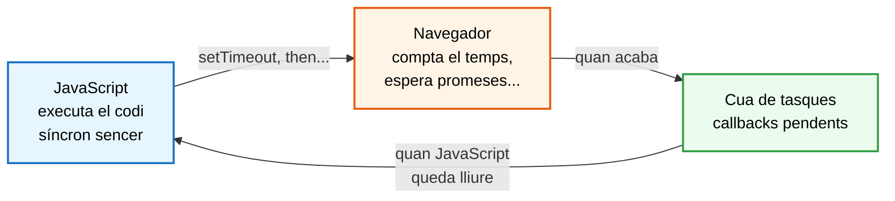
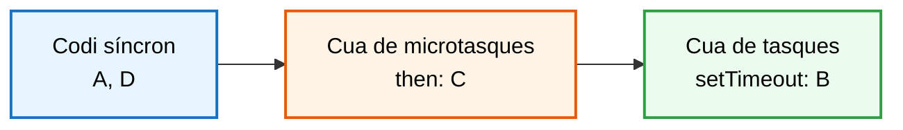

> **DSAW**  **RA7** - **ACTIVITAT 1: QUÈ SORTIRÀ PER LA CONSOLA?**
>
> **Mòdul**: Client (0612)


# Què sortirà per la consola?


## Fitxa de l'activitat

| | |
| :--- | :--- |
| **Mòdul** | 0612. Desenvolupament web en entorn client |
| **Resultat d'aprenentatge** | RA7. Desenvolupa aplicacions web dinàmiques, reconeixent i aplicant mecanismes de comunicació asíncrona entre client i servidor |
| **Tipus** | Activitat d'aprenentatge, no avaluable |
| **Modalitat** | Individual |
| **Temps estimat** | 50 min + 10 min de repte opcional |
| **Dificultat** | Bàsica |
| **Nom i cognoms** | |


## Objectius

En acabar aquesta activitat has de ser capaç de:

- Predir en quin ordre s'executa un codi que barreja instruccions síncrones i asíncrones (criteri 7.2).
- Explicar per què el temps d'un `setTimeout` és el mínim que s'espera i no el moment exacte (criteri 7.2).
- Reconèixer quan s'executa un callback que es passa a una funció pròpia i què retorna, i detectar l'error de passar-lo amb parèntesis (criteri 7.2).
- Explicar què passa quan el fil de JavaScript queda bloquejat, i per què això justifica la comunicació asíncrona (criteri 7.1).
- Reconèixer quan s'executa el codi de dins d'una `new Promise`, quan s'executen `then`, `catch` i `finally` i què rep cadascun (criteri 7.4).
- Detectar els errors més habituals amb promeses: fer servir el valor fora del `then`, oblidar el `return` en una cadena i oblidar l'`await` (criteris 7.3 i 7.4).
- Explicar què atura exactament `await` (criteri 7.2).


## Coneixements previs

| Document | Apartats |
| :--- | :--- |
| `09-comunicacio-asincrona.md` (RA7) | 1.1 a 1.4 i L'ordre d'execució, 2.1 Què és un callback, 2.2 Errors habituals, 3.1 `setTimeout`, 4.1 a 4.4 Promeses, 5.1 a 5.5 `async/await` |
| RA1 | Les eines de desenvolupador del navegador: la consola |


## Recursos lliurats

A la carpeta `A1-codi` hi trobaràs:

| Fitxer | Contingut | El pots modificar? |
| :--- | :--- | :--- |
| `index.html` | La pàgina de l'activitat: el codi de cada fragment, els camps de resposta i les solucions | No |
| `css/estils.css` | Estils de la pàgina. Els colors del codi els posa la llibreria highlight.js, que es carrega des d'internet | No |
| `js/fragments.js` | Els 15 fragments, cada un dins d'una funció | No |
| `js/dades.js` | Les dades de cada fragment: títol, solució i explicació | No |
| `js/pagina.js` | Construeix la pàgina a partir de `dades.js`, desa les respostes i mostra les solucions. No forma part de l'activitat | No |

> **Nota:** en aquesta activitat no programes. La feina és predir, comprovar i explicar. És el pas previ per poder escriure codi asíncron sense sorpreses a les activitats següents.


---

## Índex

1. [Enunciat](#1-enunciat)
2. [Codi dels fragments](#2-codi-dels-fragments)
3. [La pàgina de l'activitat](#3-la-pàgina-de-lactivitat)
4. [Criteris de correcció](#4-criteris-de-correcció)
5. [Solució](#5-solució)

[Annex: criteris d'avaluació](#annex-criteris-davaluació)


---

## 1. Enunciat

Obre `index.html` amb Live Server. La pàgina mostra 15 fragments de codi curts, agrupats en quatre blocs i un repte. Per a cada fragment has de seguir aquests passos:

1. Llegeix el codi i escriu al camp **Predicció** què creus que sortirà a la consola i en quin ordre, una línia per missatge. Fes-ho abans d'executar-lo. Els fragments mostren lletres, de manera que n'hi ha prou d'escriure les lletres en ordre. Quan el resultat és una promesa, n'hi ha prou d'escriure l'estat i el valor (`fulfilled true`).
2. Obre la consola (F12) i clica **Executa**. El botó esborra la consola i executa el fragment.
3. Clica **Mostra la solució** per comprovar el resultat i llegir-ne l'explicació, sobretot si t'has equivocat. El botó només s'activa quan has escrit la predicció. No canviïs la predicció després de veure la solució.

| Bloc | Fragments | Què hi practiques | Temps |
| :-: | :-: | :--- | :-: |
| 1 | 1 i 2 | Codi síncron i temporitzadors, fil ocupat | 10 min |
| 2 | 3 a 6 | Callbacks: passar una funció com a paràmetre, callbacks que retornen un valor, parèntesis de més, callbacks a `setTimeout` | 15 min |
| 3 | 7 a 11 | Promeses: quan s'executen, `resolve` i `reject`, `then`, encadenament i `catch` | 15 min |
| 4 | 12 a 14 | `async` i `await` | 10 min |
| Repte | 15 | Promeses contra temporitzadors | 10 min |

Els fragments 8 a 13 fan servir la funció auxiliar `esPositiu(numero)`. Si el número és positiu, la promesa es resol amb `true`; si no, falla amb un `Error` que té el missatge `false`. S'assembla a la funció `comprovarNumero` de l'apartat 4.2 de la teoria. Al bloc de promeses no hi ha temporitzadors: les promeses es resolen o fallen a l'instant, de manera que l'atenció està en `resolve`, `reject`, `then` i `catch`. Llegeix-la abans del fragment 8, que és el primer que la fa servir: fa servir l'estructura habitual d'una promesa (`new Promise`, `if`, `resolve` i `reject`).

> **Compte:** executa els fragments d'un en un i espera que acabi cada un abans de llançar el següent. Si en llances dos seguits, els missatges asíncrons de tots dos es barregen a la consola.

> **Compte:** quan la consola mostra una promesa, fixa't en la línia resumida (`Promise {<fulfilled>: true}`): indica l'estat i el valor en el moment del `console.log`.

Per fer les prediccions, fixa't en aquest esquema de l'apartat 1.4 de la teoria. El codi síncron s'executa sencer; les funcions asíncrones esperen a la cua fins que JavaScript queda lliure.




---

## 2. Codi dels fragments

La pàgina mostra el codi de cada fragment directament de `fragments.js`, de manera que el que veu l'alumnat és exactament el que s'executa. Només en mostra el cos: la funció `fragment1`, `fragment2`... que l'embolcalla no hi surt, perquè serveix només perquè el botó **Executa** el pugui llançar quan toca.

### `js/fragments.js`

```js
/* ==========================================================================
   QUÈ SORTIRÀ PER LA CONSOLA?
   Cada fragment és dins d'una funció. La pàgina mostra el contingut de cada
   una (el codi del fragment, sense la funció que l'embolcalla) i l'executa
   amb el botó Executa. També es poden executar des de la consola:
   fragment1(), fragment2()...
   Els fragments mostren lletres a la consola perquè la predicció sigui
   ràpida d'escriure: el que importa és l'ordre.
   No has de modificar aquest fitxer.
   ========================================================================== */


/* --------------------------------------------------------------------------
   BLOC 1. CODI SÍNCRON I TEMPORITZADORS
   -------------------------------------------------------------------------- */

// Fragment 1. Diversos setTimeout amb temps diferents
const fragment1 = function () {
  setTimeout(() => console.log("A"), 300);
  setTimeout(() => console.log("B"), 100);
  console.log("C");
  setTimeout(() => console.log("D"), 0);
  console.log("E");
};


// Fragment 2. El fil ocupat
const fragment2 = function () {
  const inici = Date.now();

  // Temporitzador de 500 ms
  setTimeout(() => console.log("A"), 500);

  // Bucle que manté JavaScript ocupat durant 1500 ms
  while (Date.now() - inici < 1500) {}

  console.log("B");
};


/* --------------------------------------------------------------------------
   BLOC 2. CALLBACKS
   -------------------------------------------------------------------------- */

// Funció auxiliar del fragment 6: mostra a la consola el que rep.
const mostrar = (lletra) => console.log(lletra);


// Fragment 3. Passar una funció com a paràmetre
const fragment3 = function () {
  const escriureB = () => console.log("B");

  const executarDuesVegades = function (callback) {
    callback();
    callback();
  };

  console.log("A");
  executarDuesVegades(escriureB);
  console.log("C");
};


// Fragment 4. Una funció que rep un callback
const fragment4 = function () {
  const executar = function (callback) {
    console.log("B");
    callback();
    console.log("D");
  };

  console.log("A");
  executar(() => console.log("C"));
  console.log("E");
};


// Fragment 5. Un callback que retorna un valor
const fragment5 = function () {
  const sumar = (a, b) => {
    return a + b;
  };

  const restar = (a, b) => {
    return a - b;
  };

  const calcular = function (callback) {
    const resultat = callback();
    console.log(resultat);
  };

  calcular(sumar);
  calcular(() => sumar(1, 1));
  calcular(() => restar(5, 1));
  calcular(() => sumar(1, 4) + restar(1, 3));
  calcular(restar(2, 2));
};


// Fragment 6. Un callback a setTimeout
const fragment6 = function () {
  console.log("A");
  setTimeout(mostrar("B"), 2000);
  setTimeout(() => mostrar("C"), 1000);
  console.log("D");
};


/* --------------------------------------------------------------------------
   BLOC 3. PROMESES
   -------------------------------------------------------------------------- */

// Funció auxiliar dels fragments 8 a 13: si el número és
// positiu, la promesa es resol amb true; si no, falla amb un Error que té
// el missatge "false".
const esPositiu = function (numero) {
  return new Promise((resolve, reject) => {
    if (numero > 0) {
      resolve(true);
    } else {
      reject(new Error("false"));
    }
  });
};


// Fragment 7. Quan s'executa el codi de dins de new Promise?
const fragment7 = function () {
  const numero = 5;

  console.log("A");

  const promesa = new Promise((resolve, reject) => {
    console.log("B");
    if (numero > 0) {
      resolve("C");
    } else {
      reject(new Error("E"));
    }
  });

  promesa
    .then((valor) => console.log(valor))
    .catch((error) => console.log(error.message));

  console.log("D");
};


// Fragment 8. La promesa i el seu valor
const fragment8 = function () {
  const promesa = esPositiu(5);

  console.log(promesa);

  promesa
    .then((resultat) => console.log(resultat));
};


// Fragment 9. Fer servir el valor fora del then
const fragment9 = function () {
  let resultat = false;

  esPositiu(5)
    .then((valor) => {
      resultat = valor;
      console.log(resultat);
    });

  console.log(resultat);
};


// Fragment 10. Una cadena amb un return oblidat
const fragment10 = function () {
  esPositiu(5)
    .then((resultat) => {
      console.log(resultat);
      return "B";
    })
    .then((lletra) => {
      console.log(lletra);
      lletra + "C";
    })
    .then((lletra) => {
      console.log(lletra);
    });
};


// Fragment 11. On salta l'error?
const fragment11 = function () {
  esPositiu(5)
    .then((resultat) => {
      console.log("A", resultat);
      return esPositiu(-5);
    })
    .then((resultat) => {
      console.log("B", resultat);
    })
    .catch((error) => {
      console.log("C", error.message);
    })
    .finally(() => {
      console.log("D");
    });
};


/* --------------------------------------------------------------------------
   BLOC 4. ASYNC / AWAIT
   -------------------------------------------------------------------------- */

// Fragment 12. Què s'atura amb await?
const fragment12 = function () {
  console.log("A");

  const processar = async function () {
    console.log("B");
    const resultat = await esPositiu(5);
    console.log("C", resultat);
    console.log("D");
  };

  processar();
  console.log("E");
};


// Fragment 13. Un await oblidat
const fragment13 = function () {
  const provar = async function () {
    const senseAwait = esPositiu(5);
    const ambAwait = await esPositiu(5);

    console.log(senseAwait);
    console.log(ambAwait);
  };

  provar();
};


// Fragment 14. Una funció async sempre retorna una promesa
const fragment14 = function () {
  const doble = async function (numero) {
    return numero * 2;
  };

  const resultat = doble(4);
  console.log(resultat);
  resultat
    .then((valor) => console.log(valor));
};


/* --------------------------------------------------------------------------
   REPTE (opcional). PROMESES CONTRA TEMPORITZADORS
   -------------------------------------------------------------------------- */

// Fragment 15. Un then d'una promesa ja resolta i un setTimeout de 0 ms
const fragment15 = function () {
  console.log("A");
  setTimeout(() => console.log("B"), 0);
  Promise.resolve("C")
    .then((valor) => console.log(valor));
  console.log("D");
};
```


---

## 3. La pàgina de l'activitat

Cada fragment es mostra en una targeta amb aquests elements:

| Element | Funció |
| :--- | :--- |
| Codi | El cos del fragment, i les funcions auxiliars que fa servir (`mostrar` al fragment 6). La funció `esPositiu` es mostra just abans del fragment 8 |
| Predicció | Camp de text on s'escriu què sortirà a la consola, una línia per missatge |
| Executa | Esborra la consola i executa el fragment |
| Mostra la solució | Mostra el resultat a la consola i l'explicació. Només s'activa quan el camp Predicció té text. La targeta passa a tenir la vora verda |

Les respostes es desen al navegador (`localStorage`) mentre s'escriuen: si es tanca la pàgina i es torna a obrir al mateix navegador, hi continuen. A dalt de tot, un comptador indica quants fragments tenen predicció. Al final de la pàgina, el botó **Esborra totes les respostes** buida tots els camps, després de demanar confirmació.

> **Nota:** les respostes es desen al navegador i a l'ordinador on s'han escrit. Si la pàgina es fa servir amb diversos grups al mateix ordinador, convé esborrar-les abans de començar.


---

## 4. Criteris de correcció

Activitat d'aprenentatge no avaluable. Aquesta taula et serveix per revisar el teu propi treball i per al retorn del professorat.

| Aspecte | Assolit | En procés | No assolit |
| :--- | :--- | :--- | :--- |
| **Prediccions** | Fetes abans de mirar la solució: si hi ha errades, es mantenen | Falta la predicció d'algun fragment obligatori | Les prediccions són còpies de la solució |
| **Codi síncron i temporitzadors** | Encerta l'ordre dels fragments 1 i 2, inclòs que el temporitzador del fragment 2 surt després del bucle | Encerta el fragment 1, però no el 2 | Escriu els missatges en l'ordre en què apareixen al codi |
| **Callbacks** | Encerta els fragments 3 a 6: sap que un callback s'executa quan el crida qui el rep, què retorna i detecta l'error de passar-lo amb parèntesis | Encerta l'ordre però no encerta els valors o no detecta l'error del fragment 5 | Creu que tot callback és asíncron |
| **Promeses** | Distingeix el codi que s'executa a l'instant (dins de `new Promise`) del que s'executa després (`then`), i detecta el `return` oblidat | Encerta l'ordre però no detecta algun dels errors | Confon la promesa amb el seu valor |
| **`async/await`** | Encerta l'ordre del fragment 12: sap que `await` només atura la funció `async` on és | Encerta l'ordre dels altres fragments del bloc, però no el del 12 | Creu que `await` atura tota la pàgina |


---

## 5. Solució

> **Nota:** aquestes solucions són les mateixes que mostra la pàgina amb el botó **Mostra la solució**. Comparar el teu raonament amb aquest després de fer la predicció és útil; copiar-lo, no.

### 5.1 Resultats i explicació

| Fragment | Resultat a la consola | Per què |
| :-: | :--- | :--- |
| 1 | `C` / `E` / `D` / `B` / `A` | Primer s'executa tot el codi síncron (`C` i `E`). Els tres `setTimeout` s'executen després, per ordre de temps (0, 100 i 300 ms), no per l'ordre en què estan escrits |
| 2 | `B` / `A` | El temporitzador és de 500 ms, però `A` surt després del bucle. El navegador compta els 500 ms a temps, però el fil està ocupat amb el bucle. El callback espera a la cua i s'executa quan JavaScript queda lliure, als 1500 ms aproximadament. El temps de `setTimeout` és el mínim, no l'exacte |
| 3 | `A` / `B` / `B` / `C` | `escriureB` es passa sense parèntesis, sense executar-la. Dins de `executarDuesVegades` es diu `callback`, i cada `callback()` l'executa. Qui decideix quan i quantes vegades s'executa un callback és la funció que el rep, com fa el navegador amb `addEventListener` (apartat 2.1) |
| 4 | `A` / `B` / `C` / `D` / `E` | `executar` crida el callback a la línia `callback()`: en aquell moment surt `C`, i després continua amb `D`. Passar una funció com a callback no la fa asíncrona: s'executa quan la crida la funció que l'ha rebuda. Qui fa que un callback s'executi més tard és `setTimeout`, `addEventListener` o `then` (apartat 2.1) |
| 5 | `NaN` / `2` / `4` / `3` / `Uncaught TypeError: callback is not a function` | `calcular` crida el callback sense arguments i mostra el que retorna. `sumar` es passa bé, però rep `a` i `b` buits: `undefined + undefined` és `NaN`. Les funcions anònimes es passen sense executar; quan `calcular` les crida, criden `sumar` i `restar` amb els seus valors i retornen `2`, `4` i `3`. `restar(2, 2)` amb parèntesis s'executa a l'instant: `calcular` rep `0`, que no es pot cridar (apartat 2.2) |
| 6 | `A` / `B` / `D` / `C` (al cap d'1 s) | `mostrar("B")` té parèntesis: s'executa a l'instant i a `setTimeout` li arriba `undefined`, que el navegador ignora. La funció anònima `() => mostrar("C")` es passa sense executar i es crida al cap d'1 segon (apartat 2.2 de la teoria) |
| 7 | `A` / `B` / `D` / `C` | El codi de dins de `new Promise` s'executa a l'instant, de manera síncrona: surt `B` i la promesa decideix fer `resolve`. El que és asíncron és el `then` i el `catch`: encara que la promesa ja estigui resolta, el `then` s'executa quan acaba el codi síncron. El `catch` no s'executa. Amb un número negatiu sortiria `E` pel `catch`, també després de `D` |
| 8 | `Promise {<fulfilled>: true}` / `true` | `esPositiu(5)` retorna una promesa, no el valor. Com que el número és positiu, ja s'ha resolt: estat `fulfilled` i valor `true`. La variable sempre conté la promesa; el valor s'obté amb `then` |
| 9 | `false` / `true` | El `console.log` de fora del `then` s'executa primer, quan la variable encara val `false`. El `then` s'executa després, encara que la promesa ja estigui resolta. El codi que necessita el valor ha d'anar dins del `then` |
| 10 | `true` / `B` / `undefined` | El primer `then` rep `true` i retorna `B`. Al segon `then` falta el `return`: `lletra + "C"` es calcula però no es passa a ningú, i el tercer rep `undefined` (apartat 4.4) |
| 11 | `A true` / `C false` / `D` | El primer `then` mostra `A true` i retorna `esPositiu(-5)`, que falla. El `then` de `B` se salta i l'error arriba al `catch`, que mostra el missatge `false`. `finally` s'executa sempre |
| 12 | `A` / `B` / `E` / `C true` / `D` | `processar()` s'executa de manera síncrona fins a l'`await` (`B`). Allà s'atura, encara que la promesa ja estigui resolta, i torna el control: s'executa `E`. Després continua (`C true` i `D`) |
| 13 | `Promise {<fulfilled>: true}` / `true` | Sense `await`, la constant guarda la promesa; amb `await`, el valor. És el mateix error que el del fragment 9, però amb `async/await` |
| 14 | `Promise {<fulfilled>: 8}` / `8` | Una funció `async` sempre retorna una promesa, encara que dins faci un `return` d'un número. Per obtenir el valor cal `then` o `await` (apartat 5.1) |
| 15 | `A` / `D` / `C` / `B` | Vegeu l'apartat 5.2 |

### 5.2 Repte: el fragment 15

El resultat és `A` / `D` / `C` / `B`, encara que el `setTimeout` s'hagi escrit abans que el `then` i tingui un temps de 0 ms.

El navegador no té una sola cua sinó dues. Els callbacks de `then`, `catch`, `finally` i la continuació després d'un `await` van a una cua de prioritat, la **cua de microtasques**. Els callbacks de `setTimeout`, `setInterval` i els esdeveniments van a la cua de tasques normal. Quan acaba el codi síncron, JavaScript buida primer tota la cua de microtasques i després agafa la tasca següent de la cua normal.



> **Nota:** a la pràctica no cal saber-ho per programar: el que importa és que tant el `then` com el `setTimeout` s'executen després del codi síncron. El fragment serveix per entendre per què, de vegades, un `then` "s'avança" a un temporitzador.


---

## Annex: criteris d'avaluació

| Criteri | Enunciat | Apartat del document |
| :---: | :--- | :--- |
| 7.1 | Avalua els avantatges i els inconvenients d'utilitzar mecanismes de comunicació asíncrona entre client i servidor web | Fragment 2 i la seva explicació a l'[apartat 5.1](#51-resultats-i-explicació) |
| 7.2 | Analitza els mecanismes disponibles per a l'establiment de la comunicació asíncrona | Blocs 1, 2 i 4 de l'[apartat 2](#2-codi-dels-fragments), [5.1](#51-resultats-i-explicació), [5.2](#52-repte-el-fragment-15) |
| 7.3 | Utilitza els objectes relacionats | Fragments 7, 8 i 14 (`Promise`, `Error`) |
| 7.4 | Identifica les propietats i els seus mètodes | Fragments 7 a 11 (`then`, `catch`, `finally`, `message`) |

Aquesta activitat no treballa els criteris 7.5 a 7.7 (actualització del document, formats i navegadors), que es treballen a l'A2 (`fetch`) i a les activitats A3 a A5, ni els criteris 7.8 i 7.9 (llibreries i frameworks), que corresponen a la segona part del RA.
