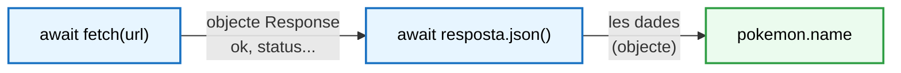

> **DSAW**  **RA7** - **ACTIVITAT 2: ENDEVINA EL FETCH**
>
> **Mòdul**: Client (0612)


# Endevina el fetch


## Fitxa de l'activitat

| | |
| :--- | :--- |
| **Mòdul** | 0612. Desenvolupament web en entorn client |
| **Resultat d'aprenentatge** | RA7. Desenvolupa aplicacions web dinàmiques, reconeixent i aplicant mecanismes de comunicació asíncrona entre client i servidor |
| **Tipus** | Activitat d'aprenentatge, no avaluable |
| **Modalitat** | Individual |
| **Temps estimat** | 55 min + 10 min de repte opcional |
| **Dificultat** | Bàsica-mitjana |
| **Nom i cognoms** | |


## Objectius

En acabar aquesta activitat has de ser capaç de:

- Explicar què retorna `fetch` i per què una petició necessita dos `await`: un per a la resposta i un altre per al cos (criteris 7.2 i 7.3).
- Llegir un fitxer JSON del mateix servidor i consultar un endpoint d'una API real (criteri 7.2).
- Llegir les propietats `ok` i `status` d'un objecte `Response` i llegir-ne el cos amb `json()` (criteri 7.4).
- Explicar per què la pàgina continua funcionant mentre s'espera la resposta del servidor (criteri 7.1).
- Saber que una variable que es modifica després d'un `await` no té el valor nou fins que arriben les dades, i on s'ha d'escriure el codi que les necessita (criteri 7.2).
- Distingir un error HTTP (el servidor respon amb un `404`, que no arriba al `catch`) d'un error de xarxa (no respon cap servidor i la promesa falla), i comprovar `ok` i `status` per convertir el primer en un error amb `throw` (criteris 7.3 i 7.4).
- Explicar per què tota petició necessita un `catch`: sense ell, un error de xarxa atura la funció sense que l'usuari en sàpiga res (criteri 7.4).
- Reconèixer que el missatge d'un error canvia d'un navegador a un altre, i no fer-ne dependre el codi (criteri 7.7).
- Organitzar una petició amb `try...catch...finally` i saber quina part del codi s'executa en cada cas (criteri 7.4).
- Treballar amb dades en format JSON i amb paràmetres a la URL (criteri 7.6).
- Fer diverses peticions una darrere l'altra amb `await` i seguir-ne el flux d'execució (criteri 7.4).


## Coneixements previs

| Document | Apartats |
| :--- | :--- |
| `09-comunicacio-asincrona.md` (RA7) | 5.1 a 5.5 `async/await`, 6.1 Actualitzar només una part de la pàgina, 6.2 Les API REST, 7.1 a 7.4 i 7.6 L'API `fetch`, 8.1 JSON |
| A1 | Blocs 3 i 4: promeses i `async/await` |


## Recursos lliurats

A la carpeta `A2-codi` hi trobaràs:

| Fitxer | Contingut | El pots modificar? |
| :--- | :--- | :--- |
| `index.html` | La pàgina de l'activitat: el codi de cada fragment, els camps de resposta i les solucions | No |
| `css/estils.css` | Estils de la pàgina. Els colors del codi els posa la llibreria highlight.js, que es carrega des d'internet | No |
| `dades/` | Els fitxers JSON del bloc 1: `lletra.json` i `lletres.json` | No |
| `js/fragments.js` | Els 15 fragments, cada un dins d'una funció | No |
| `js/dades.js` | Les dades de cada fragment: títol, solució, explicació i l'extracte de la resposta de l'API | No |
| `js/pagina.js` | Construeix la pàgina a partir de `dades.js`, mostra el contingut dels fitxers, desa les respostes i mostra les solucions. No forma part de l'activitat | No |

> **Compte:** obre la pàgina amb Live Server. Si l'obres directament des de la carpeta (`file://`), `fetch` no pot llegir els fitxers del bloc 1.

> **Compte:** el bloc 2 i el repte fan peticions a PokéAPI, una API real i pública. Necessiten connexió a internet. Convé provar-los abans de la sessió.


---

## Índex

1. [Enunciat](#1-enunciat)
2. [Codi dels fragments](#2-codi-dels-fragments)
3. [La pàgina de l'activitat](#3-la-pàgina-de-lactivitat)
4. [Criteris de correcció](#4-criteris-de-correcció)
5. [Solució](#5-solució)

[Annex: criteris d'avaluació](#annex-criteris-davaluació)


---

## 1. Enunciat

L'activitat funciona igual que l'A1. Obre `index.html` amb Live Server. La pàgina mostra 15 fragments de codi curts, agrupats en dos blocs i un repte. Tots fan peticions amb `fetch` i fan servir `async/await`, excepte el fragment 14, que fa una petició amb `then` per comparar-les. Per a cada fragment has de seguir aquests passos:

1. Mira què hi ha al fitxer o a la resposta que demana el fragment, i llegeix el codi.
2. Escriu al camp **Predicció** què creus que sortirà a la consola i en quin ordre, una línia per missatge. Fes-ho abans d'executar-lo.
3. Obre la consola (F12) i clica **Executa**. El botó esborra la consola i executa el fragment.
4. Clica **Mostra la solució** per comprovar el resultat i llegir-ne l'explicació, sobretot si t'has equivocat. El botó només s'activa quan has escrit la predicció. No canviïs la predicció després de veure la solució.

| Bloc | Fragments | Què hi practiques | Temps |
| :-: | :-: | :--- | :-: |
| 1. Llegir un fitxer JSON | 1 a 3 | Què retorna `fetch`, els dos `await` i un JSON amb una llista, amb fitxers del mateix servidor | 10 min |
| 2. Consultar un endpoint | 4 a 14 | Peticions a PokéAPI: la resposta, els dos `await`, l'`await` oblidat, la pàgina no s'atura, el 404, comprovar `ok`, un servidor que no existeix i la importància del `catch`, el patró complet amb `finally`, una variable fora de la funció, cridar la funció dues vegades i `then` | 45 min |
| Repte | 15 | Demanar una llista amb `URLSearchParams` i, després, les dades de cada element | 10 min |

### Bloc 1. Llegir un fitxer JSON

Els fragments demanen fitxers de la carpeta `dades/`, que són al mateix servidor que la pàgina. És la manera més senzilla de començar: saps exactament què hi ha a dins. La pàgina llegeix el fitxer i en mostra el contingut a cada fragment:

| Fitxer | Contingut |
| :--- | :--- |
| `dades/lletra.json` | `{ "lletra": "Z" }` |
| `dades/lletres.json` | `{ "lletres": ["X", "Y", "Z"] }` |

### Bloc 2. Consultar un endpoint

És el que faràs normalment: demanar dades a una API d'un altre servidor. Els fragments fan peticions a [PokéAPI](https://pokeapi.co/), una API pública que no necessita registre, la mateixa que fa servir la teoria als apartats 7.3 i 7.4. Cada URL que retorna un recurs és un **endpoint**:

| Endpoint | Què retorna |
| :--- | :--- |
| `https://pokeapi.co/api/v2/pokemon/pikachu` | Les dades de Pikachu (`"id": 25`, `"name": "pikachu"`...) |
| `https://pokeapi.co/api/v2/pokemon/bulbasaur` | Les dades de Bulbasaur (`"id": 1`, `"name": "bulbasaur"`...) |
| `https://pokeapi.co/api/v2/pokemon/noexisteix` | Un `404 Not Found`: el servidor existeix, però no hi ha cap pokémon amb aquest nom |
| `https://pokeapi.invalid/api/v2/pokemon/pikachu` | Res: el domini `pokeapi.invalid` no existeix, i la petició no arriba a cap servidor. Els dominis acabats en `.invalid` estan reservats i no existeixen mai |
| `https://pokeapi.co/api/v2/pokemon?limit=2&offset=0` | Una llista amb els dos primers pokémon: de cada un, el nom i la `url` del seu endpoint, que acaba amb el seu `id` (`.../pokemon/1/`) (repte) |

Les respostes de PokéAPI són molt llargues: la de Pikachu té centenars de línies. Per això cada fragment mostra un extracte amb només les propietats que fa servir el codi.

A partir del fragment 11, tots els fragments fan servir el **patró complet** d'una petició: `try`, comprovar `ok` amb un `if` i `throw`, `catch` i `finally`. Cada part del codi escriu una lletra, i les lletres segueixen l'ordre en què apareixen al codi: així es veu quina part s'executa i en quin moment.

Abans de començar, recorda que una petició té dos moments asíncrons, i que cadascun necessita el seu `await` (apartat 7.2 de la teoria):



> **Compte:** quan una petició rep un 404 o no troba el servidor, el navegador afegeix a la consola, pel seu compte, una línia vermella amb la petició (per exemple, `GET .../pokemon/noexisteix 404 (Not Found)` o, a Chrome, `GET https://pokeapi.invalid/... net::ERR_NAME_NOT_RESOLVED`). No la fa el codi: no cal que l'escriguis a la predicció.


---

## 2. Codi dels fragments

La pàgina mostra el codi de cada fragment directament de `fragments.js`, de manera que el que veu l'alumnat és exactament el que s'executa. Només en mostra el cos: la funció `fragment1`, `fragment2`... que l'embolcalla no hi surt, perquè serveix només perquè el botó **Executa** el pugui llançar quan toca.

Com que `await` només es pot fer servir dins d'una funció `async`, la majoria de fragments defineixen una funció `async` (`carregar` per als fitxers i `consultar` per a l'API) i la criden al final, igual que els exemples de la teoria.

### `js/fragments.js`

```js
/* ==========================================================================
   ENDEVINA EL FETCH
   Cada fragment és dins d'una funció. La pàgina mostra el contingut de cada
   una (el codi del fragment, sense la funció que l'embolcalla) i l'executa
   amb el botó Executa. També es poden executar des de la consola:
   fragment1(), fragment2()...
   Bloc 1: peticions als fitxers de la carpeta dades/.
     lletra.json    { "lletra": "Z" }
     lletres.json   { "lletres": ["X", "Y", "Z"] }
   Bloc 2 i repte: peticions a PokéAPI (https://pokeapi.co/api/v2/), una API
   pública que no necessita registre. Necessiten connexió a internet.
   El fragment 10 fa la petició a pokeapi.invalid, un domini que no existeix.
   Cal obrir la pàgina amb Live Server: fetch no funciona amb file://.
   No has de modificar aquest fitxer.
   ========================================================================== */


/* --------------------------------------------------------------------------
   BLOC 1. LLEGIR UN FITXER JSON
   -------------------------------------------------------------------------- */

// Fragment 1. Què retorna fetch?
const fragment1 = function () {
  const promesa = fetch("dades/lletra.json");

  console.log(promesa);
};


// Fragment 2. Els dos await
const fragment2 = function () {
  const carregar = async function () {
    const resposta = await fetch("dades/lletra.json");
    const dades = await resposta.json();

    console.log(dades);
    console.log(dades.lletra);
  };

  carregar();
};


// Fragment 3. Un JSON amb una llista
const fragment3 = function () {
  const carregar = async function () {
    const resposta = await fetch("dades/lletres.json");
    const dades = await resposta.json();

    console.log(dades.lletres.length);
    console.log(dades.lletres[0]);
    console.log(dades.lletres.join(""));
  };

  carregar();
};


/* --------------------------------------------------------------------------
   BLOC 2. CONSULTAR UN ENDPOINT
   -------------------------------------------------------------------------- */

// Fragment 4. La resposta
const fragment4 = function () {
  const consultar = async function () {
    const resposta = await fetch("https://pokeapi.co/api/v2/pokemon/pikachu");

    console.log(resposta.ok);
    console.log(resposta.status);
  };

  consultar();
};


// Fragment 5. Els dos await amb dades reals
const fragment5 = function () {
  const consultar = async function () {
    const resposta = await fetch("https://pokeapi.co/api/v2/pokemon/pikachu");
    const pokemon = await resposta.json();

    console.log(pokemon.name);
    console.log(pokemon.id);
  };

  consultar();
};


// Fragment 6. Un await oblidat
const fragment6 = function () {
  const consultar = async function () {
    const resposta = await fetch("https://pokeapi.co/api/v2/pokemon/pikachu");
    const pokemon = resposta.json();

    console.log(pokemon);
    console.log(pokemon.name);
  };

  consultar();
};


// Fragment 7. La pàgina no s'atura
const fragment7 = function () {
  const consultar = async function () {
    console.log("B");
    const resposta = await fetch("https://pokeapi.co/api/v2/pokemon/pikachu");
    const pokemon = await resposta.json();
    console.log(pokemon.name);
  };

  console.log("A");
  consultar();
  console.log("C");
};


// Fragment 8. Un recurs que no existeix
const fragment8 = function () {
  const consultar = async function () {
    try {
      const resposta = await fetch("https://pokeapi.co/api/v2/pokemon/noexisteix");
      console.log(resposta.ok);
      console.log(resposta.status);
    } catch (error) {
      console.log("A");
    }
  };

  consultar();
};


// Fragment 9. Comprovar ok
const fragment9 = function () {
  const consultar = async function () {
    try {
      const resposta = await fetch("https://pokeapi.co/api/v2/pokemon/noexisteix");
      if (!resposta.ok) {
        throw new Error(`Error ${resposta.status}`);
      }
      console.log("A");
    } catch (error) {
      console.log(error.message);
    }
  };

  consultar();
};


// Fragment 10. Un servidor que no existeix
const fragment10 = function () {
  const consultar = async function () {
    try {
      console.log("A");
      const resposta = await fetch("https://pokeapi.invalid/api/v2/pokemon/pikachu");
      console.log("B", resposta.status);
    } catch (error) {
      console.log("C", error.name);
    }
    console.log("D");
  };

  consultar();
};


// Fragment 11. El patró complet: ok, status i finally
const fragment11 = function () {
  const consultar = async function () {
    try {
      console.log("B");
      const resposta = await fetch("https://pokeapi.co/api/v2/pokemon/pikachu");
      if (!resposta.ok) {
        throw new Error(`C ${resposta.status}`);
      }
      console.log("D", resposta.ok, resposta.status);
    } catch (error) {
      console.log(error.message);
    } finally {
      console.log("E");
    }
  };

  console.log("A");
  consultar();
  console.log("F");
};


// Fragment 12. Una variable fora de la funció
const fragment12 = function () {
  let nom = "desconegut";

  const consultar = async function () {
    try {
      console.log("B", nom);
      const resposta = await fetch("https://pokeapi.co/api/v2/pokemon/pikachu");
      console.log("C", nom);
      if (!resposta.ok) {
        throw new Error(`D ${resposta.status}`);
      }
      const pokemon = await resposta.json();
      nom = pokemon.name;
      console.log("E", nom);
    } catch (error) {
      console.log(error.message);
    } finally {
      console.log("F", nom);
    }
  };

  console.log("A", nom);
  consultar();
  console.log("G", nom);
};


// Fragment 13. Cridar la funció dues vegades
const fragment13 = function () {
  const consultar = async function (nomPokemon) {
    try {
      console.log("C", nomPokemon);
      const resposta = await fetch(`https://pokeapi.co/api/v2/pokemon/${nomPokemon}`);
      if (!resposta.ok) {
        throw new Error(`D ${resposta.status}`);
      }
      const pokemon = await resposta.json();
      console.log("E", pokemon.id);
    } catch (error) {
      console.log(error.message);
    } finally {
      console.log("F", nomPokemon);
    }
  };

  const provar = async function () {
    console.log("B");
    await consultar("pikachu");
    await consultar("bulbasaur");
    console.log("G");
  };

  console.log("A");
  provar();
  console.log("H");
};


// Fragment 14. El mateix amb then
const fragment14 = function () {
  console.log("A");

  fetch("https://pokeapi.co/api/v2/pokemon/pikachu")
    .then((resposta) => {
      if (!resposta.ok) {
        throw new Error(`B ${resposta.status}`);
      }
      return resposta.json();
    })
    .then((pokemon) => console.log("C", pokemon.name))
    .catch((error) => console.log(error.message))
    .finally(() => console.log("D"));

  console.log("E");
};


/* --------------------------------------------------------------------------
   REPTE (opcional). PARÀMETRES A LA URL
   -------------------------------------------------------------------------- */

// Fragment 15. Una llista i les dades de cada element
const fragment15 = function () {
  // Retorna la llista de pokémon: el nom i la url de cada un
  const consultarLlista = async function (quantitat) {
    const parametres = new URLSearchParams({ limit: quantitat, offset: 0 });
    const resposta = await fetch(`https://pokeapi.co/api/v2/pokemon?${parametres}`);
    if (!resposta.ok) {
      throw new Error(`Error ${resposta.status}`);
    }
    const dades = await resposta.json();
    return dades.results;
  };

  // Retorna les dades d'un pokémon a partir de la url del seu endpoint
  const consultarDades = async function (url) {
    const resposta = await fetch(url);
    if (!resposta.ok) {
      throw new Error(`Error ${resposta.status}`);
    }
    return resposta.json();
  };

  const provar = async function () {
    try {
      const llista = await consultarLlista(2);
      const primer = await consultarDades(llista[0].url);
      const segon = await consultarDades(llista[1].url);

      console.log("A", primer.name, primer.id);
      console.log("B", segon.name, segon.id);
    } catch (error) {
      console.log(error.message);
    } finally {
      console.log("C");
    }
  };

  provar();
};
```


---

## 3. La pàgina de l'activitat

La pàgina és la mateixa que la de l'A1, amb un element més a cada targeta: què hi ha al fitxer o a la resposta que demana el fragment.

| Element | Funció |
| :--- | :--- |
| Contingut del fitxer (bloc 1) | El contingut real del fitxer de `dades/`. La pàgina el llegeix amb `fetch` en carregar-se, de manera que sempre coincideix amb el fitxer. Si la pàgina no s'ha obert amb Live Server, mostra un avís |
| Extracte de la resposta (bloc 2 i repte) | Les propietats de la resposta de PokéAPI que fa servir el fragment. Està escrit a `dades.js`, perquè la resposta real és massa llarga |
| Codi | El cos del fragment |
| Predicció | Camp de text on s'escriu què sortirà a la consola, una línia per missatge |
| Executa | Esborra la consola i executa el fragment |
| Mostra la solució | Mostra el resultat a la consola i l'explicació. Només s'activa quan el camp Predicció té text. La targeta passa a tenir la vora verda |

Sota el títol de cada bloc hi ha un paràgraf que explica d'on surten les dades.

Les respostes es desen al navegador (`localStorage`) mentre s'escriuen, separades de les de l'A1. A dalt de tot, un comptador indica quants fragments tenen predicció. Al final de la pàgina, el botó **Esborra totes les respostes** buida tots els camps, després de demanar confirmació.

> **Nota:** les respostes es desen al navegador i a l'ordinador on s'han escrit. Si la pàgina es fa servir amb diversos grups al mateix ordinador, convé esborrar-les abans de començar.


---

## 4. Criteris de correcció

Activitat d'aprenentatge no avaluable. Aquesta taula et serveix per revisar el teu propi treball i per al retorn del professorat.

| Aspecte | Assolit | En procés | No assolit |
| :--- | :--- | :--- | :--- |
| **Prediccions** | Fetes abans de mirar la solució: si hi ha errades, es mantenen | Falta la predicció d'algun fragment obligatori | Les prediccions són còpies de la solució |
| **Llegir un fitxer** | Encerta els fragments 1 a 3: sap que `fetch` retorna una promesa i que calen dos `await` | Encerta el 2 i el 3, però no el `pending` del fragment 1 | Creu que `fetch` retorna directament les dades |
| **La resposta de l'API** | Encerta els fragments 4 a 7: què hi ha a la resposta, les dades que arriben, l'`await` oblidat i que la pàgina no s'atura | Encerta l'ordre però no detecta l'`await` oblidat del fragment 6 | Confon l'objecte `Response` amb les dades |
| **Errors** | Encerta els fragments 8 a 11: sap que un 404 no arriba al `catch` si no es comprova `ok`, que un error de xarxa sí que hi arriba i quina part del `try...catch...finally` s'executa | Encerta els fragments amb `throw`, però creu que el 404 del fragment 8 va al `catch` o que l'error de xarxa no hi arriba | No sap quina part del codi s'executa |
| **Quan arriben les dades** | Encerta els fragments 11 i 12: el codi que hi ha després de cridar la funció s'executa abans que arribin les dades | Encerta l'ordre de les lletres, però creu que `nom` ja val `pikachu` a les línies `G` o `C` del fragment 12 | Escriu els missatges en l'ordre en què apareixen al codi |
| **Diverses peticions i `then`** | Encerta el fragment 13 (cada crida acaba abans que comenci la següent) i relaciona el fragment 14 amb el patró complet del fragment 11 | Encerta un dels dos | No encerta cap dels dos |


---

## 5. Solució

> **Nota:** aquestes solucions són les mateixes que mostra la pàgina amb el botó **Mostra la solució**. Comparar el teu raonament amb aquest després de fer la predicció és útil; copiar-lo, no.

### 5.1 Resultats i explicació

| Fragment | Resultat a la consola | Per què |
| :-: | :--- | :--- |
| 1 | `Promise {<pending>}` | `fetch` no retorna les dades, sinó una promesa. La petició s'acaba d'enviar i el servidor encara no ha respost. A l'A1, `esPositiu` es resolia a l'instant; aquí la resol el navegador quan arriba la resposta (apartat 7.1) |
| 2 | `{lletra: 'Z'}` / `Z` | Calen dos `await`: un per a la resposta (`fetch`) i un per llegir el cos (`json()`), que converteix el text en un objecte (apartat 7.2) |
| 3 | `3` / `X` / `XYZ` | Després de `json()`, `dades.lletres` és un array normal: `length`, posicions i `join` (apartat 8.1) |
| 4 | `true` / `200` | `await fetch` guarda un objecte `Response` amb la informació de la resposta HTTP, encara sense les dades. Pikachu existeix: estat `200` i `ok` val `true` (apartat 7.3) |
| 5 | `pikachu` / `25` | El mateix que el fragment 2 amb una API real. Després de `json()`, `pokemon` és un objecte i se'n llegeixen les propietats que calen (apartat 7.2) |
| 6 | `Promise {<pending>}` / `undefined` | `json()` també retorna una promesa. Sense `await`, `pokemon` és la promesa, que no té la propietat `name` (apartat 5.5) |
| 7 | `A` / `B` / `C` / `pikachu` | `consultar` s'atura al primer `await` i torna el control: surt `C`. La pàgina continua funcionant mentre s'espera el servidor, i quan arriben les dades surt `pikachu` (apartat 6.1) |
| 8 | `false` / `404` | El pokémon no existeix, però el servidor respon amb un `404`. Per a `fetch` és una resposta correcta: la promesa es resol i no arriba al `catch`. S'ha de comprovar `ok` o `status` (apartat 7.4) |
| 9 | `Error 404` | Si `ok` és `false`, el `throw` porta l'execució al `catch`, i `A` no surt. Així els errors HTTP i els de xarxa acaben al mateix lloc (apartat 7.4) |
| 10 | `A` / `C TypeError` / `D` | El domini `pokeapi.invalid` no existeix: no respon cap servidor, és un error de xarxa i la promesa de `fetch` falla. `B` no surt i el `catch` mostra `C TypeError`. Després del `try...catch`, la funció continua i mostra `D`. Sense el `catch`, l'error quedaria sense capturar (`Uncaught (in promise) TypeError`) i `D` no sortiria. El fragment mostra `error.name` perquè el missatge canvia segons el navegador (`Failed to fetch` a Chrome, `NetworkError when attempting to fetch resource.` a Firefox) (apartat 7.4) |
| 11 | `A` / `B` / `F` / `D true 200` / `E` | Surt `A`. `consultar` comença i el `try` mostra `B`. A l'`await` s'atura i torna el control: surt `F`. Quan arriba la resposta, `ok` és `true` i l'estat, `200`: l'`if` no fa `throw`, `C` no surt i es mostra `D true 200`. El `catch` no s'executa i el `finally` mostra `E`. Amb `pokemon/noexisteix` sortiria `A` / `B` / `F` / `C 404` / `E` (apartats 5.3 i 7.4) |
| 12 | `A desconegut` / `B desconegut` / `G desconegut` / `C desconegut` / `E pikachu` / `F pikachu` | `consultar` s'atura a l'`await` del `fetch` i la línia de després de la crida mostra `G desconegut`. Quan arriba la resposta surt `C desconegut`: encara no s'ha llegit el cos. Després de `json()` s'assigna el nom (`E pikachu`) i el `finally` mostra `F pikachu`. Només a partir de `E` la variable té el valor: el codi que necessita les dades s'ha d'escriure dins de la funció, després de l'`await`. És l'error del fragment 9 de l'A1 amb una petició real |
| 13 | `A` / `B` / `C pikachu` / `H` / `E 25` / `F pikachu` / `C bulbasaur` / `E 1` / `F bulbasaur` / `G` | `provar` comença (`B`) i crida `consultar("pikachu")` (`C pikachu`). A l'`await` del `fetch`, `consultar` s'atura, i `provar`, que l'espera, també: surt `H`. Quan arriba la resposta de Pikachu surten `E 25` i `F pikachu`, i llavors comença la consulta de Bulbasaur. `G` surt al final. Sense `await`, les dues peticions començarien alhora i les respostes podrien arribar en qualsevol ordre (apartat 5.2) |
| 14 | `A` / `E` / `C pikachu` / `D` | És el patró complet del fragment 11 amb `then`: el primer `then` comprova `ok` i retorna `resposta.json()`, el segon rep les dades, i el `catch` i el `finally` fan la mateixa feina. El codi síncron (`A` i `E`) surt primer; quan arriben les dades surt `C pikachu`, i el `finally` mostra `D` (apartats 5.4 i 7.4) |
| 15 | `A bulbasaur 1` / `B ivysaur 2` / `C` | Vegeu l'apartat 5.2 |

### 5.2 Repte: el fragment 15

És una situació molt habitual quan es treballa amb una API: primer es demana una llista i, després, les dades de cada element. Cada tasca és en una funció, i cada funció fa la petició, comprova `ok` i retorna les dades:

| Funció | Què fa | Què retorna |
| :--- | :--- | :--- |
| `consultarLlista(quantitat)` | Demana la llista a `pokemon?limit=2&offset=0` | L'array `results`: el nom i la `url` de cada pokémon |
| `consultarDades(url)` | Demana l'endpoint d'un pokémon | Les dades completes del pokémon |

`consultarLlista` construeix els paràmetres `limit=2&offset=0` amb `URLSearchParams`: es volen 2 elements a partir del primer (apartat 7.6). Cada element de la llista no porta totes les dades del pokémon, sinó el nom i la `url` del seu endpoint, que acaba amb el seu `id`: `https://pokeapi.co/api/v2/pokemon/1/`.

`provar` espera la llista i, després, les dades de cada pokémon, una petició darrere l'altra, perquè no es poden demanar els pokémon fins que no ha arribat la llista. Surten `A bulbasaur 1` i `B ivysaur 2`, i el `finally` mostra `C`.

Les dues funcions llancen l'error amb `throw`, però no tenen `catch`. Si una petició falla, l'error arriba al `catch` de `provar`: un error dins d'una funció que s'espera amb `await` arriba al `catch` de qui l'ha cridada.


---

## Annex: criteris d'avaluació

| Criteri | Enunciat | Apartat del document |
| :---: | :--- | :--- |
| 7.1 | Avalua els avantatges i els inconvenients d'utilitzar mecanismes de comunicació asíncrona entre client i servidor web | Fragments 7, 11 i 12 (la pàgina continua mentre s'espera el servidor, i el codi de després de la crida s'executa abans que arribin les dades) |
| 7.2 | Analitza els mecanismes disponibles per a l'establiment de la comunicació asíncrona | Blocs 1 i 2 (un fitxer del mateix servidor i un endpoint d'una API), fragments 1, 5, 12 i 14, diagrama de l'[apartat 1](#1-enunciat) |
| 7.3 | Utilitza els objectes relacionats | `Response` (fragments 4 i 8), `Error` (fragments 9 i 11 a 15), `TypeError` (fragment 10), `URLSearchParams` (fragment 15) |
| 7.4 | Identifica les propietats i els seus mètodes | `ok`, `status`, `json()` (fragments 2 a 11), `catch` i `finally` (fragments 9 a 15), `await` successius (fragment 13) |
| 7.6 | Utilitza diferents formats en l'enviament i la recepció d'informació | JSON (fragments 2, 3 i 5), paràmetres a la URL (fragment 15, [apartat 5.2](#52-repte-el-fragment-15)) |
| 7.7 | Programa aplicacions web asíncrones de manera que funcionin a diferents navegadors | Fragment 10: el missatge de l'error de xarxa és diferent a cada navegador, i per això el codi en mostra el tipus (`error.name`). Cobertura parcial |

Aquesta activitat no treballa el criteri 7.5 (actualització del document web), perquè només fa servir la consola. Es treballa a les activitats A3 a A5 i a les activitats de `fetch` amb DOM. Tampoc no treballa els criteris 7.8 i 7.9 (llibreries i frameworks), que corresponen a la segona part del RA. El criteri 7.1 només es toca a les explicacions; es treballa a fons a l'A3 i a l'A5.
