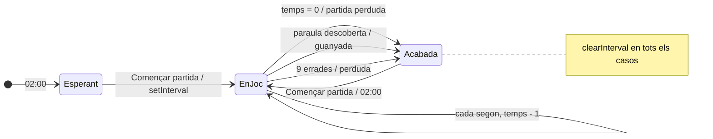
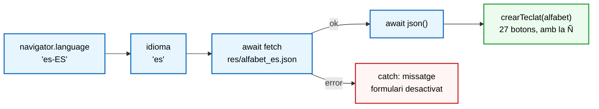

> **DSAW**  **RA7** - **ACTIVITAT 3: ENDEVINA LA PARAULA, TEMPS I IDIOMES**
>
> **Mòdul**: Client (0612)


# Endevina la paraula: temps i idiomes


## Fitxa de l'activitat

| | |
| :--- | :--- |
| **Mòdul** | 0612. Desenvolupament web en entorn client |
| **Resultat d'aprenentatge** | RA7. Desenvolupa aplicacions web dinàmiques, reconeixent i aplicant mecanismes de comunicació asíncrona entre client i servidor |
| **Tipus** | Activitat d'aprenentatge, no avaluable |
| **Modalitat** | Individual |
| **Temps estimat** | 3 h |
| **Dificultat** | Mitjana |
| **Nom i cognoms** | |


## Objectius

En acabar aquesta activitat has de ser capaç de:

- Programar una tasca que es repeteix cada segon amb `setInterval`, i aturar-la amb `clearInterval` quan ja no cal (criteris 7.2 i 7.4).
- Llegir un fitxer JSON amb `fetch`, `async` i `await`, i comprovar si la resposta ha anat bé (criteris 7.3, 7.4 i 7.6).
- Triar el fitxer que es demana segons l'idioma del navegador (criteri 7.2).
- Actualitzar la pàgina amb les dades rebudes: crear el teclat a partir de l'alfabet llegit (criteri 7.5).
- Gestionar els errors amb `try...catch` i informar l'usuari (criteri 7.4).
- Comprovar que l'aplicació funciona en dos navegadors diferents (criteri 7.7).
- Treballar en una branca de Git.


## Recursos lliurats

A la carpeta `A3-joc` hi ha:

| Fitxer | Contingut |
| :--- | :--- |
| `index.html` | L'enunciat per a l'alumnat, enllaçat des de l'índex de les activitats del RA7 |
| `res/alfabet_ca.json` | Alfabet català: 27 lletres, amb la `Ç` |
| `res/alfabet_es.json` | Alfabet castellà: 27 lletres, amb la `Ñ` |
| `res/alfabet_en.json` | Alfabet anglès: 26 lletres |

La solució completa és a `solucions/A3-joc`: és el joc de la solució del RA3 (`PROPOSTES/RA3-FE/ACTIVITATS/A1-codi`) amb els canvis d'aquesta activitat.

> **Nota:** l'alumnat parteix del seu propi joc del RA3, no del de la solució. Els noms de les funcions i dels elements de l'enunciat són orientatius.


---

## Índex

1. [Enunciat](#1-enunciat)
2. [Requisits tècnics](#2-requisits-tècnics)
3. [Ampliació opcional](#3-ampliació-opcional)
4. [Pla de proves](#4-pla-de-proves)
5. [Solució](#5-solució)

[Annex: criteris d'avaluació](#annex-criteris-davaluació)


---

## 1. Enunciat

Es parteix del joc **Endevina la paraula** del RA3 i s'hi afegeixen dues funcionalitats asíncrones: un compte enrere de 2 minuts per a cada partida, i un teclat que es crea a partir d'un fitxer JSON amb l'alfabet de l'idioma del navegador.

| Part | Funcionalitat | Què s'hi practica | Temps |
| :-: | :--- | :--- | :-: |
| 0 | Branca nova `asyncron` | Git: branques, *commits* i `push` | 15 min |
| 1 | Compte enrere de 2 minuts | `setInterval`, `clearInterval`, format `mm:ss` | 1 h 15 min |
| 2 | Alfabet segons l'idioma del navegador | `fetch`, `async/await`, `ok`, `json()`, `try...catch`, `createElement` | 1 h 15 min |
| — | Proves en dos navegadors | Pla de proves | 15 min |

### Part 0. Una branca nova: `asyncron`

Cal crear una branca nova anomenada `asyncron` al repositori del joc.

### Part 1. Compte enrere de 2 minuts

1. A la pantalla del joc hi ha un element que mostra el temps restant en format `mm:ss`. Abans de la primera partida diu `02:00`.
2. En començar una partida, el temps torna a `02:00` i baixa cada segon amb `setInterval`.
3. Quan arriba a `00:00`, la partida es dona per perduda, igual que quan s'acaben les errades: es mostra la paraula, el panell surt amb el fons vermell, es fan els càlculs del total de partides i el teclat es desactiva.
4. El compte enrere s'atura amb `clearInterval` sempre que acaba la partida: per temps, per victòria o per errades.



### Part 2. L'alfabet segons l'idioma del navegador

1. Els tres fitxers (`alfabet_ca.json`, `alfabet_es.json` i `alfabet_en.json`) es desen a la carpeta `res/` de l'arrel del projecte. Tots tenen la mateixa estructura:

    ```json
    {
      "alfabet": ["A", "B", "C", "Ç", "D", "E", "F", "G", "H", "I", "J", "K", "L", "M", "N", "O", "P", "Q", "R", "S", "T", "U", "V", "W", "X", "Y", "Z"]
    }
    ```

2. Una funció `async` rep el codi de l'idioma (els dos primers caràcters de `navigator.language`, que el joc ja calcula a la pantalla inicial) i retorna l'array de lletres.
3. Si l'idioma no és cap dels tres, es carrega l'alfabet anglès.
4. La petició es fa amb `fetch` i `await`, es comprova `ok` (amb `throw` si la resposta no és correcta) i el cos es llegeix amb `json()`.
5. El teclat es crea a partir de l'array rebut, amb `createElement`. La constant amb les lletres escrites a mà desapareix.
6. Mentre l'alfabet no ha arribat, el formulari de la paraula està desactivat.
7. Si no es pot llegir el fitxer, l'error es captura amb `try...catch` i es mostra un missatge a la pàgina.



> **Compte:** cal obrir el joc amb Live Server. Amb `file://`, `fetch` no pot llegir el fitxer.

Per provar els tres idiomes, cal canviar l'idioma preferit del navegador (Configuració, Idiomes) i tornar a entrar al joc des de la pantalla inicial, que és on es llegeix `navigator.language`.


---

## 2. Requisits tècnics

1. El compte enrere es fa amb `setInterval` i s'atura amb `clearInterval`.
2. L'alfabet es llegeix amb `fetch` i `async/await`.
3. Cada funció nova està comentada.
4. Es mantenen els criteris d'acceptació de la pràctica del RA3: res d'`innerHTML` ni `insertAdjacentHTML`, capes separades, estructura de carpetes amb `index.html` a l'arrel, cap error a la consola i botons creats amb `createElement`.


---

## 3. Ampliació opcional

**Els últims segons.** Quan queden 10 segons o menys, el rellotge canvia de color, afegint una classe.


---

## 4. Pla de proves

S'ha de fer en dos navegadors diferents (per exemple, Chrome i Firefox).

| # | Acció | Resultat esperat |
| :-: | :--- | :--- |
| 1 | Obrir el joc amb el navegador en català | El teclat té 27 lletres, amb la `Ç`. El rellotge diu `02:00` |
| 2 | Canviar el navegador a castellà i tornar a entrar des de la pantalla inicial | 27 lletres, amb la `Ñ` |
| 3 | Canviar-lo a anglès | 26 lletres |
| 4 | Canviar-lo a un altre idioma (per exemple, francès) | Es carrega l'alfabet anglès: 26 lletres |
| 5 | Canviar el nom d'un fitxer de `res/` i tornar a entrar | Surt un missatge a la pàgina, no hi ha teclat i no es pot començar cap partida |
| 6 | Començar una partida | El rellotge comença a `02:00` i baixa cada segon |
| 7 | Deixar passar els 2 minuts | A `00:00` es mostra la paraula, el panell es posa vermell, el total de partides augmenta en 1 i el teclat es desactiva. El rellotge no continua baixant |
| 8 | Començar una partida nova | El rellotge torna a `02:00` |
| 9 | Guanyar una partida abans d'acabar el temps | El rellotge s'atura on era i la partida es compta una sola vegada |
| 10 | Perdre una partida per errades abans d'acabar el temps | El rellotge s'atura i la partida es compta una sola vegada |
| 11 | Revisar la consola durant totes les proves | No hi ha cap error |


---

## 5. Solució

La solució parteix del joc de la solució del RA3 (`PROPOSTES/RA3-FE/ACTIVITATS/A1-codi`). El projecte complet és a `solucions/A3-joc`. Només canvien `joc.html` i `js/joc.js`, i s'afegeix la carpeta `res/` amb els tres alfabets.

> **Nota:** la solució del RA3 declara les funcions amb `function nom() {...}`. Per coherència amb aquest codi, les funcions noves també es declaren així, encara que als apunts del RA7 es faci servir `const nom = function () {...}`.

### 5.1 `joc.html`

S'afegeix el rellotge al panell del jugador:

```html
    <aside class="info-jugador" aria-label="Informació del jugador">
      <h2 id="nom-jugador"></h2>
      <!-- RA7: compte enrere de la partida, en format mm:ss -->
      <p>Temps restant<span id="temps">02:00</span></p>
      ...
    </aside>
```

### 5.2 `js/joc.js`: constants, elements i estat

La constant `LLETRES` desapareix. En el seu lloc:

```js
const TEMPS_PARTIDA = 120;                // segons de cada partida (2 minuts)
const IDIOMES = ["ca", "es", "en"];       // idiomes que tenen fitxer d'alfabet
const IDIOMA_PER_DEFECTE = "en";          // si el navegador fa servir un altre idioma
```

```js
const textTemps = document.querySelector("#temps");
```

```js
let tempsRestant = TEMPS_PARTIDA;   // segons que queden de la partida
let idCompteEnrere = null;          // identificador del setInterval
```

### 5.3 `js/joc.js`: el teclat a partir de l'alfabet

`crearTeclat` ja no fa servir una constant, sinó l'array que rep:

```js
/**
 * Crea un botó per a cada lletra de l'alfabet. Tots comencen deshabilitats.
 * @param {string[]} lletres Lletres de l'alfabet carregat del fitxer JSON.
 */
function crearTeclat(lletres) {
  for (const lletra of lletres) {
    const boto = document.createElement("button");
    boto.type = "button";
    boto.className = "tecla";
    boto.textContent = lletra;
    boto.disabled = true;
    boto.addEventListener("click", () => provarLletra(lletra, boto));

    teclat.append(boto);
    botonsLletres.push(boto);
  }
}
```

### 5.4 `js/joc.js`: el compte enrere

```js
/* =========================================================================
   4b. COMPTE ENRERE (RA7)
   ========================================================================= */

/**
 * Mostra el temps restant amb el format mm:ss.
 */
function mostrarTemps() {
  const minuts = Math.floor(tempsRestant / 60);
  const segons = tempsRestant % 60;
  // padStart afegeix un 0 al davant si cal: 5 -> "05"
  textTemps.textContent = `${String(minuts).padStart(2, "0")}:${String(segons).padStart(2, "0")}`;
}

/**
 * Resta un segon al compte enrere. En arribar a 0, la partida es perd.
 * L'executa setInterval cada segon.
 */
function restarSegon() {
  tempsRestant--;
  mostrarTemps();

  if (tempsRestant === 0) {
    acabarPartida(false);
  }
}

/**
 * Atura el compte enrere, si n'hi ha un en marxa.
 */
function aturarCompteEnrere() {
  if (idCompteEnrere !== null) {
    clearInterval(idCompteEnrere);
    idCompteEnrere = null;
  }
}

/**
 * Posa el compte enrere a 2 minuts i el comença.
 */
function iniciarCompteEnrere() {
  aturarCompteEnrere();   // per si en quedava un d'una partida anterior
  tempsRestant = TEMPS_PARTIDA;
  mostrarTemps();
  idCompteEnrere = setInterval(restarSegon, 1000);
}
```

El compte enrere comença al final d'`iniciarPartida`:

```js
function iniciarPartida() {
  ...
  panellParaula.classList.remove("guanyada", "perduda");
  crearCaselles();
  habilitarTeclat(true);
  mostrarGlobus();
  mostrarInfoJugador();
  actualitzarTitol();
  iniciarCompteEnrere();   // RA7: 2 minuts per endevinar la paraula
}
```

I s'atura al principi d'`acabarPartida`, que és on acaben totes les partides (per temps, per victòria o per errades):

```js
function acabarPartida(guanyada) {
  aturarCompteEnrere();   // RA7: tant si es guanya com si es perd
  partidaEnCurs = false;
  ...
}
```

### 5.5 `js/joc.js`: l'alfabet segons l'idioma

```js
/* =========================================================================
   4c. ALFABET SEGONS L'IDIOMA (RA7)
   ========================================================================= */

/**
 * Llegeix l'alfabet de l'idioma indicat des del seu fitxer JSON.
 * Si l'idioma no té fitxer, es fa servir el de l'idioma per defecte.
 * @param {string} idioma Codi de dues lletres ("ca", "es", "en"...).
 * @returns {Promise<string[]>} Les lletres de l'alfabet.
 */
async function carregarAlfabet(idioma) {
  const codi = IDIOMES.includes(idioma) ? idioma : IDIOMA_PER_DEFECTE;
  const resposta = await fetch(`res/alfabet_${codi}.json`);

  if (!resposta.ok) {
    throw new Error(`Error ${resposta.status} en llegir l'alfabet`);
  }

  const dades = await resposta.json();
  return dades.alfabet;
}
```

### 5.6 `js/joc.js`: l'arrencada

El codi d'arrencada passa a una funció `async`, perquè ha d'esperar l'alfabet abans de crear el teclat:

```js
/**
 * Prepara la pantalla del joc. El teclat no es pot crear fins que no ha
 * arribat l'alfabet; mentrestant, el formulari queda deshabilitat.
 */
async function arrencar() {
  document.body.classList.add(infoNavegador.classeFons);
  textIdioma.textContent = infoNavegador.idioma;
  mostrarInfoJugador();
  actualitzarTitol();
  mostrarTemps();
  habilitarFormulari(false);

  try {
    const alfabet = await carregarAlfabet(infoNavegador.idioma);
    crearTeclat(alfabet);
    habilitarFormulari(true);
  } catch (error) {
    // Sense alfabet no hi ha teclat: no es pot jugar
    console.error(error);
    textAvis.textContent = "No s'ha pogut carregar l'alfabet. Obre el joc amb Live Server i torna-ho a provar.";
  }
}

if (jugador.nom === null || infoNavegador === null) {
  location.replace("index.html");
} else {
  arrencar();
}
```

### 5.7 Ampliació

A `mostrarTemps`, una classe al rellotge quan queden 10 segons o menys. El color es defineix al CSS:

```js
textTemps.classList.toggle("ultims-segons", tempsRestant <= 10);
```

```css
.ultims-segons { color: var(--error); font-weight: bold; }
```

### 5.8 Decisions de disseny de la solució

- **`acabarPartida` per a tots els finals.** El temps esgotat no té codi propi: crida `acabarPartida(false)`, que ja mostra la paraula, posa el fons vermell i actualitza el total de partides. Per això `clearInterval` va al principi d'`acabarPartida`: s'atura en tots els finals de partida.
- **`aturarCompteEnrere` abans de començar.** `iniciarCompteEnrere` atura el compte enrere anterior, si n'hi havia. Així no hi ha mai dos `setInterval` en marxa alhora, que farien baixar el temps el doble de ràpid.
- **L'identificador a `null`.** Després de `clearInterval`, l'identificador es posa a `null`, de manera que `aturarCompteEnrere` es pot cridar sense saber si hi ha un compte enrere en marxa.
- **L'anglès per defecte.** Si el navegador fa servir un idioma que no té fitxer, es carrega l'alfabet anglès, que és el que té menys lletres afegides.
- **L'idioma de `sessionStorage`.** El joc ja guarda l'idioma a la pantalla inicial (`navigator.language.slice(0, 2)`). No cal tornar-lo a calcular.
- **El formulari desactivat mentre es carrega.** `crearTeclat` necessita l'alfabet, que arriba de manera asíncrona. Si es pogués començar una partida abans, no hi hauria tecles.
- **El missatge d'error.** L'error real es mostra a la consola (`console.error`) per depurar-lo, i a la pàgina es mostra un missatge que l'usuari entén.


---

## Annex: criteris d'avaluació

| Criteri | Enunciat | Apartat del document |
| :---: | :--- | :--- |
| 7.1 | Avalua els avantatges i els inconvenients d'utilitzar mecanismes de comunicació asíncrona entre client i servidor web | [5.8](#58-decisions-de-disseny-de-la-solució) (el formulari desactivat mentre arriba l'alfabet). Cobertura parcial |
| 7.2 | Analitza els mecanismes disponibles per a l'establiment de la comunicació asíncrona | Parts 1 (temporitzadors) i 2 (`fetch`) de l'[apartat 1](#1-enunciat) |
| 7.3 | Utilitza els objectes relacionats | `Response` i `Error` (part 2) |
| 7.4 | Identifica les propietats i els seus mètodes | `setInterval`, `clearInterval`, `ok`, `json()`, `try...catch` ([5](#5-solució)) |
| 7.5 | Utilitza comunicació asíncrona en l'actualització dinàmica del document web | Teclat creat a partir de les dades rebudes, rellotge i missatge d'error |
| 7.6 | Utilitza diferents formats en l'enviament i la recepció d'informació | Els tres fitxers JSON de l'alfabet |
| 7.7 | Programa aplicacions web asíncrones de manera que funcionin a diferents navegadors | [Pla de proves](#4-pla-de-proves) en dos navegadors. Cobertura parcial |

Aquesta activitat no treballa els criteris 7.8 i 7.9 (llibreries i frameworks), que corresponen a la segona part del RA.
