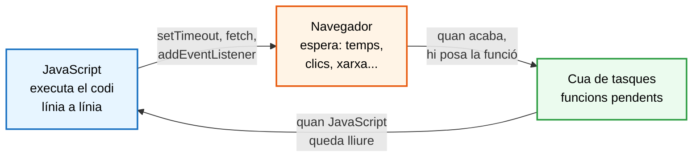
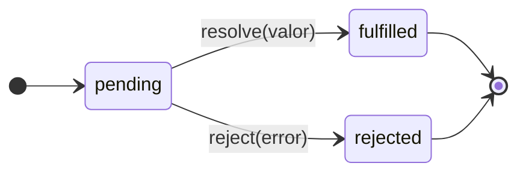
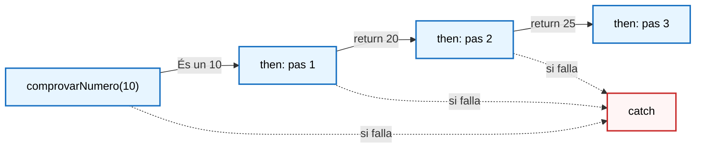
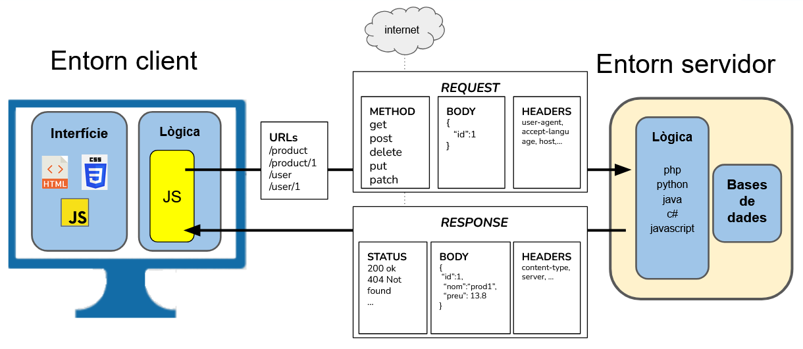
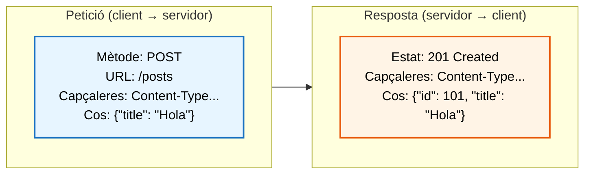
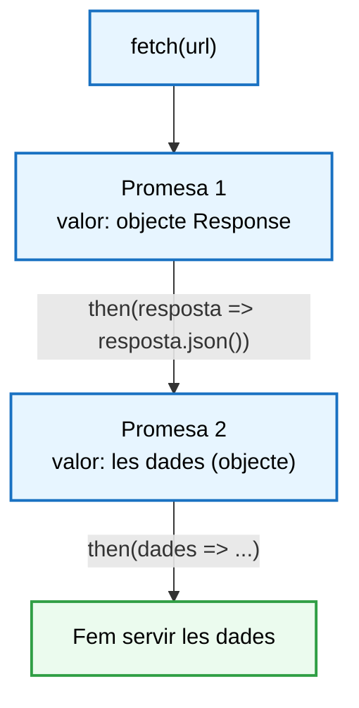
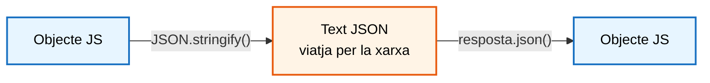

> **DSAW**  **RA7** - **COMUNICACIÓ ASÍNCRONA**
>
> **Mòdul**: Client (0612)
>
> **Estat**: **En revisió**


# Comunicació asíncrona: callbacks, promeses i fetch


## Què aprendràs

En acabar aquesta unitat has de ser capaç de:

- Diferenciar el codi **síncron** del codi **asíncron** i predir en quin ordre s'executa.
- Passar funcions com a **callback** i programar tasques amb `setTimeout` i `setInterval`.
- Crear i consumir **promeses** amb `then`, `catch` i `finally`.
- Escriure codi asíncron llegible amb `async` i `await`.
- Demanar i enviar dades a un servidor amb **fetch** i gestionar-ne els errors.
- Treballar amb diferents formats de dades (JSON, text, formularis).
- Actualitzar la pàgina amb les dades rebudes sense recarregar-la.

> **Nota:** aquest document és la primera part de la RA7. La segona part (llibreries i frameworks, React) es treballa al final del mòdul.

---

## Índex

1. [Execució síncrona i asíncrona](#1-execució-síncrona-i-asíncrona)
2. [Callbacks](#2-callbacks)
3. [Temporitzadors](#3-temporitzadors)
4. [Promeses](#4-promeses)
5. [async / await](#5-async--await)
6. [La comunicació asíncrona amb el servidor](#6-la-comunicació-asíncrona-amb-el-servidor)
7. [L'API fetch](#7-lapi-fetch)
8. [Formats d'intercanvi de dades](#8-formats-dintercanvi-de-dades)


---

## 1. Execució síncrona i asíncrona

### 1.1 El codi síncron

Per defecte, JavaScript executa el codi **línia a línia**: fins que una línia no acaba, no comença la següent. Això és el **codi síncron**.

```js
console.log("primera línia");
console.log("segona línia");
console.log("tercera línia");

// Resultat:
// primera línia
// segona línia
// tercera línia
```

Amb funcions passa el mateix: el codi de dins d'una funció s'executa en el moment en què es **crida**.

```js
const mostrar = function () {
  console.log("dins de la funció");
};

console.log("primera línia");
mostrar();
console.log("tercera línia");

// Resultat:
// primera línia
// dins de la funció
// tercera línia
```

### 1.2 El problema del bloqueig

Si una línia triga molt, tot el que ve darrere s'espera. Un exemple fàcil de veure és `alert`:

```js
console.log("abans de l'alerta");
alert("Prem Acceptar per continuar");   // el codi s'atura aquí
console.log("després de l'alerta");      // no s'executa fins que l'usuari accepta
```

Mentre es mostra l'alerta, la pàgina no respon: no es pot fer clic enlloc ni s'executa cap altre codi. Ara imagina que en lloc d'una alerta fos una petició a un servidor que triga 5 segons: la pàgina quedaria congelada 5 segons.

### 1.3 El codi asíncron

El **codi asíncron** permet començar una tasca llarga i **continuar** amb la resta del programa sense esperar-la. Quan la tasca acaba, s'executa el codi que l'havia de tractar.

```js
console.log("primera línia");

const mostrar = () =>{
    console.log("dins de la funció (3 segons després)");
}

setTimeout(mostrar, 3000);

console.log("tercera línia");

// Resultat:
// primera línia
// tercera línia
// dins de la funció (3 segons després)
```

`setTimeout` no atura el programa: deixa la funció programada i el codi continua. Per això "tercera línia" surt abans.

Exemples de tasques asíncrones al navegador:

| Tasca | Eina |
| :--- | :--- |
| Esperar una acció de l'usuari | `addEventListener` |
| Esperar un temps | `setTimeout`, `setInterval` |
| Demanar dades a un servidor | `fetch` |
| Obtenir la ubicació | `navigator.geolocation` |

### 1.4 Com funciona l'execució assíncrona

JavaScript té un **sol fil d'execució**: només pot fer una cosa alhora.  Les funcionalitats llistades anteriorment (setTimeout, setInterval, addEventListener, fetch, navigator.geolocation) les ofereix el navegador. Quan el nostre codi en crida alguna, JavaScript encarrega la feina al navegador (comptar el temps, fer una petició al servidor, esperar el clic...) i continua executant la següent línia. Quan la feina acaba, el navegador posa a la cua la funció que li havíem passat, i JavaScript l’executa quan ha acabat el que estava fent.

**Qui espera no és JavaScript, és el navegador**.




**Què passa si el fil del JavaScript està ocupat quan acaba l'espera?** Ho veiem amb un `setTimeout` d'1 segon i un bucle que bloqueja el fil durant 2 segons:

```js
const inici = Date.now();

const mostrar = () =>{
    console.log(`setTimeout executat als ${Date.now() - inici} ms`);
}

setTimeout(mostrar, 1000);

// Bucle que manté JavaScript ocupat durant 2 segons
while (Date.now() - inici < 2000) {}

console.log("Fi del bucle");

// Resultat:
// Fi del bucle
// setTimeout executat als 2000 ms (aproximadament)
```

El navegador ha comptat el segon a temps, però no pot executar la funció ja que el fil principal encara està ocupat. 

> **Recorda:** el temps de `setTimeout` és el **mínim** que esperarà la funció, no el moment exacte en què s'executarà. Si el fil està ocupat, s'endarrereix.

### L'ordre d'execució

Què mostra aquest codi?

```js
console.log("A");
setTimeout(() => console.log("B"), 0);
console.log("C");
```
>Resultat: `A`, `C`, `B`. Encara que l'espera sigui 0, el callback de `setTimeout` va a la cua i només s'executa quan acaba tot el codi síncron.
---

## 2. Callbacks

### 2.1 Què és un callback

Un **callback** és una funció que es passa com a paràmetre a una altra funció perquè aquesta la cridi quan li toqui.

```js
// Funció que rep una altra funció com a paràmetre
const funcioPrincipal = function (callback) {
  console.log("Faig la meva feina...");
  callback();   // quan acabo, crido el callback
};

// Funció que enviarem com a paràmetre
const funcioParam = () => {
  console.log("Executo la funció rebuda per paràmetre");
};

funcioPrincipal(funcioParam);

// Resultat:
// Faig la meva feina...
// Executo la funció rebuda per paràmetre
```

### 2.2 Errors habituals

Primer error: posar parèntesis. Amb parèntesis no passem la funció, l'**executem** i passem el que retorna (`undefined`).

```js
// MALAMENT: funcioParam s'executa ara i es passa undefined
funcioPrincipal(funcioParam());

// BÉ: es passa la funció, sense parèntesis
funcioPrincipal(funcioParam);
```

Segon cas: el callback necessita paràmetres. No podem escriure `mostrar("Hola")` perquè s'executaria en el moment. La solució és encapsular-la dins una funció anònima:

```js
const mostrarText = (text) => console.log(text);

// MALAMENT: s'executa abans de temps
funcioPrincipal(mostrarText("Hola"));

// BÉ: la funció anònima es passa sense executar; quan es cridi, cridarà mostrarText("Hola")
funcioPrincipal(() => mostrarText("Hola"));
```

> **Compte:** és el mateix motiu pel qual a `addEventListener` escrivim `() => calcular(mostrarConsola)` i no `calcular(mostrarConsola)`.

---

## 3. Temporitzadors

### 3.1 `setTimeout` i `clearTimeout`

`setTimeout` executa una funció **una vegada** passat un temps en mil·lisegons.

```js
const id = setTimeout(callback, temps);
```

| Element | Significat |
| :--- | :--- |
| `callback` | Funció que s'executarà |
| `temps` | Mil·lisegons d'espera (1000 = 1 segon) |
| `id` | Identificador del temporitzador, per poder-lo cancel·lar |

Exemple: un missatge que apareix als 3 segons, amb un botó per cancel·lar-lo.

```html
<button id="cancelar">Cancel·lar</button>
<p id="missatge"></p>
```

```js
const missatge = document.querySelector("#missatge");

const idMissatge = setTimeout(() => {
  missatge.textContent = "Han passat 3 segons";
}, 3000);

document.querySelector("#cancelar").addEventListener("click", () => {
  clearTimeout(idMissatge);   // el missatge ja no apareixerà
  missatge.textContent = "Cancel·lat";
});
```

### 3.2 `setInterval` i `clearInterval`

`setInterval` executa una funció **repetidament**, cada cert temps, fins que s'atura amb `clearInterval`.

```js
// Comptador que suma 1 cada segon i s'atura en arribar a 5
let comptador = 0;

const idInterval = setInterval(() => {
  comptador++;
  console.log(comptador);

  if (comptador === 5) {
    clearInterval(idInterval);   // aturem l'interval
    console.log("Fi");
  }
}, 1000);
```

Exemple més complet: un compte enrere amb format `mm:ss`.

```html
<p id="rellotge">02:00</p>
```

```js
const rellotge = document.querySelector("#rellotge");
let tempsTotal = 120;   // segons

const comptadorDec = function () {
    tempsTotal--;

    const minuts = Math.floor(tempsTotal / 60);
    const segons = tempsTotal % 60;
    // padStart afegeix un 0 al davant si cal: 5 -> "05"
    rellotge.textContent = `${String(minuts).padStart(2, "0")}:${String(segons).padStart(2, "0")}`;

    if (tempsTotal === 0) {
        clearInterval(idCompte);
        rellotge.textContent = "Temps esgotat";
    }
}

const idCompte = setInterval(comptadorDec, 1000);
```

> **Compte:** guarda sempre l'identificador de l'interval. Sense ell no el pots aturar i la funció s'executarà indefinidament.

---

## 4. Promeses

### 4.1 Què és una promesa

Una **promesa** (*Promise*) és un objecte que representa el resultat d'una **tasca asíncrona** que encara no ha acabat. És com el tiquet que et donen en un restaurant de menjar ràpid: encara no tens el menjar, però tens un objecte que diu "quan estigui llest, t'avisarem", i pot acabar bé (et donen el menú) o malament (s'ha acabat el pa).

Una promesa sempre està en un d'aquests tres estats:



| Estat | Significat | Resultat |
| :--- | :--- | :--- |
| `pending` | La tasca encara no ha acabat | `undefined` |
| `fulfilled` | Ha anat bé | El valor obtingut |
| `rejected` | Hi ha hagut un error | L'error |

Un cop la promesa passa a `fulfilled` o `rejected`, ja no canvia mai més.


### 4.2 Crear una promesa

Es crea amb `new Promise` i una funció que rep dos paràmetres: `resolve` (es crida quan va bé) i `reject` (es crida quan va malament).

L'exemple més simple possible:

```js
const promesa = new Promise((resolve, reject) => {
  const x = 10;

  if (x === 10) {
    resolve("És un 10");               // tot ha anat bé: la promesa passa a fulfilled
  } else {
    reject("No és un 10");  // alguna cosa ha fallat: la promesa passa a rejected
  }
});

console.log(promesa);   // Promise {<fulfilled>: "És un 10"}
```

Una promesa és, doncs, una "capsa" que acabarà contenint un resultat bo (el que es passa a `resolve`) o un error (el que es passa a `reject`). Canvia `x = 10` per `x = 5` i torna-ho a provar: la consola mostrarà `Promise {<rejected>: Error: No és un 10}`.

Aquesta promesa només es pot fer servir una vegada, i sempre amb el mateix valor de `x`. Per això, normalment la promesa es retorna des d'una funció. Així la podem cridar tantes vegades com vulguem i amb valors diferents:

```js
const comprovarNumero = function (x) {
  return new Promise((resolve, reject) => {
    if (x === 10) {
      resolve("És un 10");                 // la promesa passa a fulfilled
    } else {
      reject("No és un 10");    // la promesa passa a rejected
    }
  });
};

console.log(comprovarNumero(10));   // Promise {<fulfilled>: "És un 10"}
console.log(comprovarNumero(5));    // Promise {<rejected>: Error: No és un 10}
```

Fixa't que `console.log` mostra la promesa, no el missatge.

> **Nota:** amb `comprovarNumero(5)` la consola també mostra un error en vermell (`Uncaught (in promise) Error: No és un 10`). Apareix perquè la promesa ha fallat i ningú no ha capturat l'error. Amb `catch` (apartat següent) desapareix.

A `resolve` i a `reject` se'ls pot passar **qualsevol valor**: un text, un número, un booleà, un array o un objecte. Aquest valor és el que rebrem quan consumim la promesa (apartat següent).

```js
// Un número
const promesaNumero = new Promise((resolve, reject) => {
  resolve(42);
});

// Un array
const promesaArray = new Promise((resolve, reject) => {
  resolve(["A", "B", "C"]);
});

// Un objecte
const promesaObjecte = new Promise((resolve, reject) => {
  resolve({ nom: "Laia", curs: "DAW2", nota: 8.5 });
});

console.log(promesaNumero);    // Promise {<fulfilled>: 42}
console.log(promesaArray);     // Promise {<fulfilled>: ["A", "B", "C"]}
console.log(promesaObjecte);   // Promise {<fulfilled>: {nom: "Laia", curs: "DAW2", nota: 8.5}}
```

> **Nota:** el cas més habitual a la pràctica és rebre un objecte o un array. És el que passarà amb `fetch`: el servidor envia dades en format JSON i acabem tenint un objecte o un array de JavaScript (apartat 7).

### 4.3 `then`, `catch` i `finally`

Una promesa no es pot llegir directament. Per obtenir-ne el resultat cal dir-li què fer quan acabi:

| Mètode | S'executa quan... | Rep |
| :--- | :--- | :--- |
| `then(funcio)` | la promesa va bé | El valor del `resolve` |
| `catch(funcio)` | la promesa falla | L'error del `reject` |
| `finally(funcio)` | acaba, vagi bé o malament | Res |

```js
// Cas bo: s'executa el then
comprovarNumero(10)
  .then((missatge) => console.log(missatge))      // És un 10
  .catch((error) => console.log(error.message))
  .finally(() => console.log("Fi"));              // Fi

// Cas dolent: s'executa el catch
comprovarNumero(5)
  .then((missatge) => console.log(missatge))
  .catch((error) => console.log(error.message))   // No és un 10
  .finally(() => console.log("Fi"));              // Fi
```

`finally` és útil per a tasques que s'han de fer sempre al final, com amagar un missatge de "Carregant...".

> **Compte:** el `then` s'executa **després** del codi síncron, encara que la promesa ja estigui resolta. Per això el valor només es pot fer servir **dins** del `then`.

```js
let resultat = "";

comprovarNumero(10).then((missatge) => {
  resultat = missatge;
});

console.log(resultat);   // MALAMENT: mostra "", el then encara no s'ha executat
```

### 4.4 Encadenar promeses

Sovint una tasca té diversos passos i cada pas necessita el resultat de l'anterior. Amb les promeses es poden posar diversos `then` un darrere l'altre: cada `then` rep el valor que ha retornat (`return`) el `then` anterior.

```js
comprovarNumero(10)
  .then((missatge) => {
    console.log("Pas 1:", missatge);         // Pas 1: És un 10
    return 10 * 2;                           // passem 20 al pas següent
  })
  .then((doble) => {
    console.log("Pas 2: el doble és", doble);   // Pas 2: el doble és 20
    return doble + 5;                           // passem 25 al pas següent
  })
  .then((resultat) => {
    console.log("Pas 3: el resultat és", resultat);   // Pas 3: el resultat és 25
  })
  .catch((error) => {
    console.log("Error:", error);
  });
```

El valor viatja d'un `then` al següent com en una cadena de muntatge:



> **Recorda:** si oblides el `return` dins d'un `then`, el següent rep `undefined`.

### 4.5 Combinar promeses

A vegades cal llançar diverses tasques alhora i esperar-les totes. Per a això hi ha mètodes de l'objecte `Promise`:

| Mètode | Retorna |
| :--- | :--- |
| `Promise.all([p1, p2])` | Un array amb tots els resultats. Si una falla, va al `catch` |
| `Promise.allSettled([p1, p2])` | Un array amb el resultat de cadascuna, hagi anat bé o malament |
| `Promise.race([p1, p2])` | El resultat de la primera que acabi |

`Promise.all` espera que acabin totes. Si totes van bé, el `then` rep un array amb els resultats, en el mateix ordre:

```js
Promise.all([comprovarNumero(10), comprovarNumero(10)])
  .then((resultats) => {
    console.log(resultats);   // ["És un 10", "És un 10"]
  })
  .catch((error) => {
    console.log("Error:", error);
  });
```

N'hi ha prou que una falli perquè tot vagi al `catch`:

```js
Promise.all([comprovarNumero(10), comprovarNumero(5)])
  .then((resultats) => {
    console.log(resultats);          // no s'executa
  })
  .catch((error) => {
    console.log("Error:", error);    // Error: No és un 10
  });
```

Si volem saber què ha passat amb cadascuna, encara que alguna falli, fem servir `Promise.allSettled`. Mai va al `catch`: el `then` rep un objecte per promesa amb el seu estat:

```js
Promise.allSettled([comprovarNumero(10), comprovarNumero(5)])
  .then((resultats) => {
    console.log(resultats);
    // [
    //   { status: "fulfilled", value: "És un 10" },
    //   { status: "rejected",  reason: "No és un 10" }
    // ]
  });
```

---

## 5. async / await

### 5.1 Funcions `async`

`async` i `await` són una manera més còmoda d'escriure codi amb promeses: el codi asíncron es llegeix com si fos síncron.

Una funció marcada amb `async` **sempre retorna una promesa**:

```js
const saludar = async function () {
  return "Hola";
};

console.log(saludar());                        // Promise {<fulfilled>: "Hola"}
saludar().then((text) => console.log(text));   // Hola
```

`async` també es pot posar davant d'una arrow function:

```js
const saludar = async () => {
  return "Hola";
};
```

### 5.2 L'operador `await`

`await` es posa davant d'una promesa i **espera** que acabi. Retorna directament el valor del `resolve`, sense haver d'escriure `then`.

```js
const provar = async function () {
  const missatge = await comprovarNumero(10);
  console.log(missatge);   // És un 10
};

provar();
```

> **Nota:** `await` només atura la funció `async` on és. La resta de la pàgina continua funcionant.

### 5.3 Errors amb `try...catch...finally`

Amb `await`, els errors es capturen amb el `try...catch` de sempre. `finally` fa el mateix paper que a les promeses.

```js
const provar = async function (x) {
  try {
    const missatge = await comprovarNumero(x);
    console.log(missatge);
  } catch (error) {
    console.log(error.message);   // si la promesa falla, venim aquí
  } finally {
    console.log("Fi");
  }
};

provar(10);   // És un 10 / Fi
provar(5);    // No és un 10 / Fi
```

### 5.4 `then` o `async/await`

Fan exactament el mateix. Compara:

```js
// Amb then
const provarThen = function (x) {
  comprovarNumero(x)
    .then((missatge) => console.log(missatge))
    .catch((error) => console.log(error.message))
    .finally(() => console.log("Fi"));
};

// Amb async/await
const provarAwait = async function (x) {
  try {
    const missatge = await comprovarNumero(x);
    console.log(missatge);
  } catch (error) {
    console.log(error.message);
  } finally {
    console.log("Fi");
  }
};
```

| | `then` / `catch` | `async` / `await` |
| :--- | :--- | :--- |
| Lectura | Cadena de funcions | De dalt a baix, com codi normal |
| Errors | `.catch()` | `try...catch` |
| Quan fer-lo servir | Codi curt, una sola petició | Diversos passos seguits |

Els dos estils es poden barrejar: una funció `async` retorna una promesa i es pot consumir amb `then`.

### 5.5 Errors habituals

Oblidar el `await`: la variable guarda la promesa, no el valor.

```js
const provar = async function () {
  const missatge = comprovarNumero(10);          // MALAMENT: falta await
  console.log(missatge);                         // Promise {<fulfilled>: "És un 10"}

  const missatge2 = await comprovarNumero(10);   // BÉ
  console.log(missatge2);                        // És un 10
};
```

Fer servir `await` fora d'una funció `async`:

```js
const provar = function () {
  const missatge = await comprovarNumero(10);   // MALAMENT: SyntaxError
};
```

---

## 6. La comunicació asíncrona amb el servidor

### 6.1 Actualitzar només una part de la pàgina

Al model tradicional, cada vegada que l'usuari demana alguna cosa, el servidor envia una **pàgina sencera** i el navegador la torna a carregar.

Amb la **comunicació asíncrona** (sovint anomenada **AJAX**), JavaScript demana **només les dades** en segon pla i actualitza el tros de pàgina que cal. L'usuari pot continuar fent servir la pàgina mentrestant.


### 6.2 Les API REST

Les dades se solen demanar a una **API REST**: un servidor que ofereix **recursos** (usuaris, productes, publicacions...) a través d'**URL**, i on el **mètode HTTP** indica què volem fer-hi.

| Mètode | Acció | Exemple d'URL | Què fa |
| :--- | :--- | :--- | :--- |
| `GET` | Llegir | `/posts` | Retorna totes les publicacions |
| `GET` | Llegir | `/posts/1` | Retorna la publicació 1 |
| `POST` | Crear | `/posts` | Crea una publicació nova |
| `PUT` | Substituir | `/posts/1` | Substitueix tota la publicació 1 |
| `PATCH` | Modificar | `/posts/1` | Canvia només alguns camps |
| `DELETE` | Esborrar | `/posts/1` | Esborra la publicació 1 |

Cada intercanvi té una **petició** (*request*) i una **resposta** (*response*):



El JavaScript del client envia una petició a una URL amb un mètode, unes capçaleres i, si cal, un cos amb dades. El servidor la processa (consultant la base de dades si cal) i retorna una resposta amb un codi d'estat, unes capçaleres i un cos amb les dades demanades.

Un exemple concret de petició i resposta:



Els codis d'estat més habituals ja els coneixes: `200 OK`, `201 Created`, `400 Bad Request`, `401 Unauthorized`, `404 Not Found`, `500 Internal Server Error`.


---

## 7. L'API fetch

### 7.1 Primera petició GET

`fetch(url)` fa una petició HTTP i retorna una **promesa**. Partim d'aquest fitxer del joc del penjat:

```json
{
  "alfabet": ["A", "B", "C", "Ç", "D", "E", "F", "G", "H", "I", "J", "K", "L",
              "M", "N", "O", "P", "Q", "R", "S", "T", "U", "V", "W", "X", "Y", "Z"]
}
```

```js
fetch("/res/alfabet_ca.json")
  .then((resposta) => {
    // 1r then: rebem la resposta HTTP, encara sense llegir el contingut
    return resposta.json();   // llegim el cos com a JSON (retorna una altra promesa)
  })
  .then((dades) => {
    // 2n then: ja tenim les dades convertides a objecte
    console.log(dades.alfabet);   // ["A", "B", "C", ...]
  })
  .catch((error) => {
    console.error("No s'ha pogut carregar l'alfabet:", error);
  });
```

El mateix amb `async/await`:

```js
const carregarAlfabet = async function () {
  try {
    const resposta = await fetch("/res/alfabet_ca.json");
    const dades = await resposta.json();
    console.log(dades.alfabet);
  } catch (error) {
    console.error("No s'ha pogut carregar l'alfabet:", error);
  }
};

carregarAlfabet();
```

### 7.2 Per què hi ha dos `then`

La petició té dos moments asíncrons: primer arriba la **resposta** (estat i capçaleres) i després s'acaba de llegir el **cos** amb les dades. Cadascun és una promesa.



> **Recorda:** el primer `then` **ha de fer `return resposta.json()`**. Sense el `return`, el segon `then` rep `undefined`.

### 7.3 L'objecte `Response`

La resposta que retorna `fetch` és un objecte `Response` amb aquestes propietats i mètodes:

| Propietat | Valor |
| :--- | :--- |
| `ok` | `true` si l'estat és entre 200 i 299 |
| `status` | Codi d'estat: `200`, `404`, `500`... |
| `statusText` | Text de l'estat: `"OK"`, `"Not Found"`... |
| `url` | URL final de la resposta |
| `headers` | Capçaleres de la resposta. Es llegeixen amb `headers.get("nom")` |

| Mètode | Llegeix el cos com a... | Retorna |
| :--- | :--- | :--- |
| `json()` | JSON, i el converteix en objecte | Promesa amb l'objecte |
| `text()` | Text | Promesa amb un string |
| `blob()` | Fitxer binari (imatges, PDF...) | Promesa amb un `Blob` |

```js
const veureResposta = async function () {
  const resposta = await fetch("https://pokeapi.co/api/v2/pokemon/pikachu");

  console.log(resposta.ok);                            // true
  console.log(resposta.status);                        // 200
  console.log(resposta.statusText);                    // "OK"
  console.log(resposta.headers.get("Content-Type"));   // "application/json; charset=utf-8"

  const pokemon = await resposta.json();
  console.log(pokemon.name);                           // "pikachu"
  console.log(pokemon.sprites.front_default);          // URL de la imatge
};
```

> **Compte:** el cos només es pot llegir **una vegada**. Si fas `resposta.json()` i després `resposta.text()`, el segon dona error.

### 7.4 Errors de xarxa i errors HTTP

Hi ha dos tipus d'error i `fetch` els tracta diferent:

| Situació | Exemple | Què fa `fetch` |
| :--- | :--- | :--- |
| Error de xarxa | Sense connexió, servidor inexistent | La promesa falla: va al `catch` |
| Error HTTP | `404 Not Found`, `500` | La promesa **va bé**: `ok` val `false` |

Per tant, un `404` **no arriba al `catch`** si no el controlem nosaltres. La pràctica habitual és comprovar `ok` i llançar un error:

```js
fetch("https://pokeapi.co/api/v2/pokemon/noexisteix")
  .then((resposta) => {
    if (!resposta.ok) {
      // Error HTTP: el convertim en error perquè vagi al catch
      throw new Error(`Error ${resposta.status}: ${resposta.statusText}`);
    }
    return resposta.json();
  })
  .then((pokemon) => {
    console.log(pokemon.name);
  })
  .catch((error) => {
    console.error(error.message);   // Error 404: Not Found
  })
  .finally(() => {
    console.log("Petició acabada");
  });
```

Amb `async/await`:

```js
const obtenirPokemon = async function (nom) {
  try {
    const resposta = await fetch(`https://pokeapi.co/api/v2/pokemon/${nom}`);

    if (!resposta.ok) {
      throw new Error(`Error ${resposta.status}: ${resposta.statusText}`);
    }

    const pokemon = await resposta.json();
    console.log(pokemon.name);
  } catch (error) {
    console.error(error.message);
  } finally {
    console.log("Petició acabada");
  }
};

obtenirPokemon("pikachu");      // pikachu
obtenirPokemon("noexisteix");   // Error 404: Not Found
```

### 7.5 Opcions de la petició: `method`, `headers` i `body`

Per defecte `fetch` fa un `GET`. Per a la resta de mètodes es passa un segon paràmetre amb les opcions:

| Opció | Per a què |
| :--- | :--- |
| `method` | `"GET"`, `"POST"`, `"PUT"`, `"PATCH"`, `"DELETE"` |
| `headers` | Capçaleres: tipus de contingut, autorització... |
| `body` | Les dades que enviem (sempre com a text o formulari, mai un objecte directament) |

> **Recorda:** als exemples d'aquest apartat i del següent, el codi amb `await` s'ha d'escriure dins d'una funció `async`.

POST: crear un recurs.

```js
const crearPublicacio = async function () {
  const novaPublicacio = { title: "Hola", body: "Primer post", userId: 1 };

  const resposta = await fetch("https://jsonplaceholder.typicode.com/posts", {
    method: "POST",
    headers: {
      "Content-Type": "application/json"   // avisem que el cos és JSON
    },
    body: JSON.stringify(novaPublicacio)   // objecte -> text JSON
  });

  console.log(resposta.status);            // 201
  const creada = await resposta.json();
  console.log(creada);                     // { title: "Hola", body: "Primer post", userId: 1, id: 101 }
};
```

> **Compte:** si envies JSON, posa sempre la capçalera `"Content-Type": "application/json"`. Sense ella, el servidor pot no entendre el cos.

PUT i PATCH: modificar un recurs.

```js
// PUT: substitueix tota la publicació 1
await fetch("https://jsonplaceholder.typicode.com/posts/1", {
  method: "PUT",
  headers: { "Content-Type": "application/json" },
  body: JSON.stringify({ id: 1, title: "Títol nou", body: "Text nou", userId: 1 })
});

// PATCH: només canvia el títol
await fetch("https://jsonplaceholder.typicode.com/posts/1", {
  method: "PATCH",
  headers: { "Content-Type": "application/json" },
  body: JSON.stringify({ title: "Només canvio el títol" })
});
```

DELETE: esborrar un recurs. Normalment no porta cos.

```js
const resposta = await fetch("https://jsonplaceholder.typicode.com/posts/1", {
  method: "DELETE"
});

console.log(resposta.ok);   // true
```

Moltes API demanen identificar-se amb un **token** a la capçalera `Authorization`:

```js
const resposta = await fetch(url, {
  method: "POST",
  headers: {
    "Content-Type": "application/json",
    "Authorization": `Bearer ${token}`
  },
  body: JSON.stringify(dades)
});
```

### 7.6 Paràmetres a la URL

Per filtrar o cercar amb `GET`, les dades van a la URL després de `?`. Amb `URLSearchParams` es construeixen sense errors (espais, accents...):

```js
// Publicacions de l'usuari 1
const parametres = new URLSearchParams({ userId: 1 });
const url = `https://jsonplaceholder.typicode.com/posts?${parametres}`;

console.log(url);   // https://jsonplaceholder.typicode.com/posts?userId=1

const resposta = await fetch(url);
const publicacions = await resposta.json();
console.log(publicacions.length);   // 10
```

---

## 8. Formats d'intercanvi de dades

### 8.1 JSON

És el format més utilitzat. Ja el coneixes del document *Objectes predefinits*: per enviar fem `JSON.stringify()` i per rebre fem `resposta.json()`, que equival a `JSON.parse()` del cos.




> **Compte:** fes servir `innerHTML` només amb contingut que ve del teu propi servidor. Si el text pot venir d'un usuari, fes servir `textContent`.

### 8.2 Formularis: `FormData` i `URLSearchParams`

`FormData` agafa tots els camps d'un formulari d'un cop (fan servir l'atribut `name`). Es pot enviar directament com a `body`; el navegador posa la capçalera adequada automàticament.

```html
<form id="formulari">
  <input name="nom" value="Laia">
  <input name="email" value="laia@institut.cat">
  <button>Enviar</button>
</form>
```

```js
const formulari = document.querySelector("#formulari");
const dades = new FormData(formulari);

// Opció 1: enviar el formulari tal qual (format multipart/form-data)
await fetch("/api/registre", { method: "POST", body: dades });

// Opció 2: convertir-lo en objecte i enviar-lo com a JSON
const objecte = Object.fromEntries(dades);   // { nom: "Laia", email: "laia@institut.cat" }
await fetch("/api/registre", {
  method: "POST",
  headers: { "Content-Type": "application/json" },
  body: JSON.stringify(objecte)
});
```

`URLSearchParams` també es pot fer servir com a `body`: envia les dades en el mateix format que un formulari HTML clàssic (`nom=Laia&email=...`).

```js
await fetch("/api/registre", {
  method: "POST",
  body: new URLSearchParams({ nom: "Laia", email: "laia@institut.cat" })
});
```

### 8.4 Resum de formats

| Format | Enviar (`body`) | Capçalera `Content-Type` | Rebre |
| :--- | :--- | :--- | :--- |
| JSON | `JSON.stringify(objecte)` | `application/json` (l'has de posar tu) | `resposta.json()` |
| Text / HTML | Un string | `text/plain`, `text/html` | `resposta.text()` |
| Formulari | `new FormData(form)` | `multipart/form-data` (automàtica) | — |
| Formulari clàssic | `new URLSearchParams(...)` | `application/x-www-form-urlencoded` (automàtica) | — |
| Imatges, fitxers | `FormData` amb el fitxer | automàtica | `resposta.blob()` |

> **Nota:** amb la capçalera `Accept` el client pot indicar quin format vol rebre, per exemple `headers: { "Accept": "application/json" }`. La majoria d'API ja retornen JSON per defecte.

---

